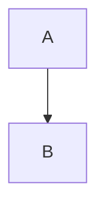

# Michael Ikirodah — Technical Architecture

Technical architecture monograph and infrastructure specifications built with **Jekyll** and hosted on **GitHub Pages**.

Live: [clrzr.github.io](https://clrzr.github.io)

---

## Financial Infrastructure

All specifications live in `_case_studies/` (rendered via Jekyll collections):

| Specification | Path | Focus |
|---|---|---|
| **A Ledger's Core Model** | `_case_studies/ledger.md` (`/engineering/fintech/ledger/`) | Double-entry accounting, pooled accounts, held funds, and reliable state recovery. |
| **Payment Intent Architecture** | `_case_studies/payments.md` (`/engineering/fintech/payments/`) | A destination-first payment flow, checks run in parallel, and one ID used to prevent duplicate payments. |
| **Continuous Signal Risk Engine** | `_case_studies/fraud.md` (`/engineering/fintech/fraud/`) | Behavioural signals collected in the background, impossible-travel detection, and real-time risk caching. |
| **Device Boundary & Identity Engine** | `_case_studies/kyc.md` (`/engineering/fintech/kyc/`) | Identity checks that run in the background, provider failover, protected personal data, and one active device per account. |

---

## Diagrams

Diagrams use **Mermaid.js**. They are rendered client-side on all pages using the `system` layout. Simply write standard fenced Mermaid blocks:

````markdown

````

---

## Project Structure

```
_case_studies/  ← Architecture specifications
_data/          ← Site metadata and navigation
_layouts/       ← Shared layouts (base.html, system.html)
_includes/      ← Shared components (nav.html)
images/         ← Visual assets
index.html      ← Selected specifications index
about/          ← Background, focus, and architectural principles
_config.yml     ← Jekyll settings and collection permalinks
Gemfile         ← Ruby dependencies
```

---

## Deployment

Push to `main`. GitHub Pages detects `_config.yml`, runs Jekyll, and deploys automatically.

