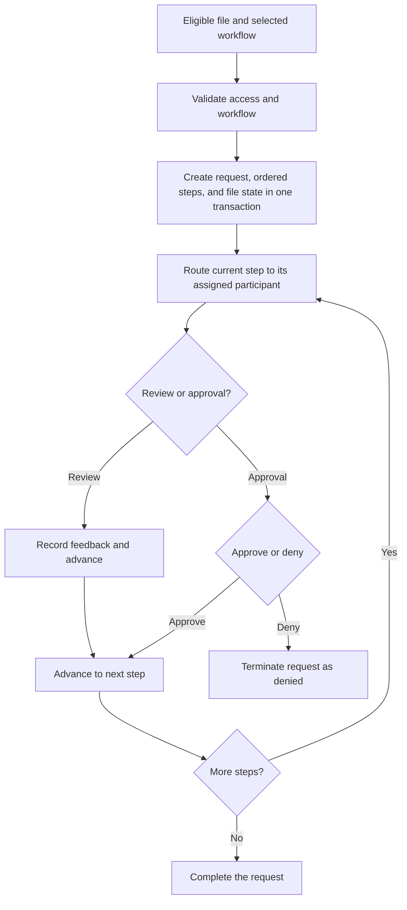
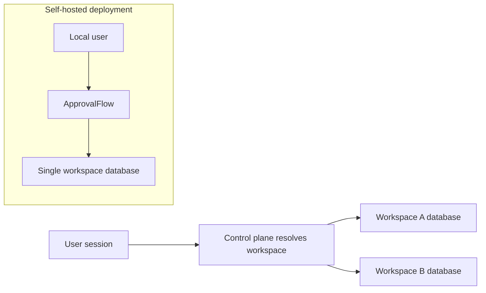

ApprovalFlow had to make document decisions traceable without making workflows brittle. A request needed to preserve who acted and when, distinguish review from authorization, and still allow additional steps when a process proved incomplete. I worked through those constraints with the client's technical lead in recurring technical and design reviews, shaping the workflow rules and data boundaries around them.

The engineering problem was to make the decision path explicit in the system, while allowing it to change in controlled ways.

<figure class="case-image">
  
  <figcaption>ApprovalFlow sign-in screen</figcaption>
</figure>

## Model approval as a sequence of state transitions

ApprovalFlow represents a request as an approval record plus an ordered set of process steps. Each step has an assignee, type, outcome, and place in the sequence. Rather than treating every action as a generic status update, the system applies different transition rules to review and approval steps.

This structure reflects an important distinction in the work: review contributes feedback, while approval makes the decision. A review cannot deny a request, and when a workflow includes approval, validation requires an approval step at the end. That keeps the process from reaching a terminal state that looks like a decision but is only a review.

The request and its ordered steps are created together in a database transaction, along with the file's transition into review. When someone acts, the system checks that the person is the assigned participant and that earlier steps permit the action. It locks the current PostgreSQL step and verifies it is still pending before changing state. If two actions race, the second one sees that the step has already moved and is rejected. The database state, rather than a potentially stale screen, determines what happened.

## Allow a process to change, but not without permission

A fixed sequence is easy to understand until someone discovers a missing reviewer after the request is underway. Restarting the process would discard useful progress; letting anyone edit the sequence would weaken accountability.

ApprovalFlow permits a participant with process-modification permission to insert a review or append further steps. This makes the workflow adaptable at a defined boundary. The original sequence is not immutable, but changes are authorized actions recorded within the process.

## Make workspace separation an infrastructure boundary

The institution needed both a self-hosted installation for its own work and hosted workspaces for the universities it served. Each workspace needed its own data enclosure. Shared-database isolation, including row-level security, was considered, but did not satisfy the requirement for physical separation.

The system therefore uses a control-plane database for workspace and authentication-routing information, and a separate PostgreSQL database for each workspace's operational data. In hosted mode, the control plane resolves the workspace from the user's session and routes the request to its database. In self-hosted mode, the installation requires one registered workspace.

This boundary makes tenant provisioning, migrations, connection management, and identity synchronization more involved. Some identity updates use coordinated retries and rollback across the control plane and tenant databases. Other user-management paths do not use that centralized synchronization service, so the repository does not establish that every identity change is kept consistent. The architecture accepts operational complexity to keep workspace data separate, while identity synchronization remains an area where the implementation is not uniform.

## Keep files usable without making a file link the authority

Files live in local storage or an S3-compatible service behind a storage abstraction. Uploads are hashed for deduplication. Duplicate uploads by the same owner are prevented, and workspace-wide duplicate blocking can be configured. These checks happen in application code without a database uniqueness constraint, so simultaneous identical uploads can still race.

The database record and stored bytes cannot be committed in one transaction. If database registration fails, the application attempts to remove the uploaded bytes. This cleanup is best-effort, rather than a distributed transaction across PostgreSQL and the storage service.

Documents also need to be read and, for Office formats, edited during the workflow. ApprovalFlow integrates ONLYOFFICE with a signed, file-specific configuration. The application still checks the user's session and relationship to the file when serving it; possessing a signed file token alone is not sufficient authorization. The trade-off is that document editing stays in the workflow, while the deployment must also operate an external document-editor service.

## Keep notifications outside the authoritative state change

When a step advances, the system records the workflow change in PostgreSQL and schedules notifications separately. An outbox tracks notification work, with deterministic identifiers to make repeated inserts safe. Notification delivery is not the source of truth for approval state.

The repository shows retry state for pending notifications, but does not establish a periodic worker that reliably replays every pending item. Email failures are logged. The implementation therefore supports retry-safe notification processing, but the available evidence does not justify describing delivery as guaranteed.

## Report what the process did, not what it proves

Because the request records its steps and timestamps, reports can derive approval, rejection, and review status, completion duration, monthly throughput, weekday timing, and per-step service-target performance. Managers can use these measures to examine the process.

The system records and reports activity. The repository does not establish that approval times improved, that service targets were met in production, or that the audit log satisfies a particular compliance standard.

ApprovalFlow's engineering center is the request state: an ordered, permissioned process whose transitions are checked and recorded. Separate workspace databases protect the data boundary; file and notification systems support the process without becoming its authority. Those choices reflect the institution's need for decisions that can be followed and reviewed, while preserving controlled flexibility when a document needs more scrutiny.
