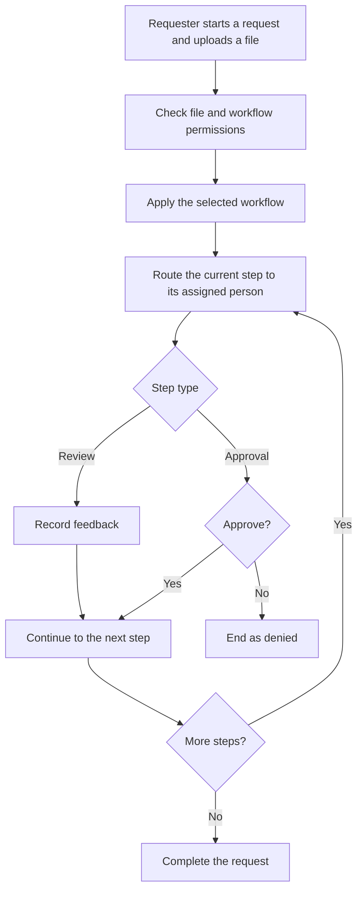
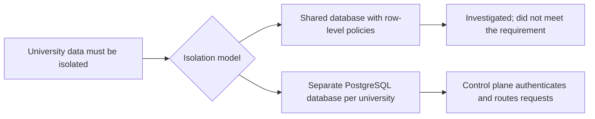

Built for a government institution serving universities, ApprovalFlow takes a document from request to an authorized decision. The path needs to make feedback count, let people correct a request that skipped required steps, and protect files whose readers differ by document—all while keeping each university's data separate.

<figure class="case-image">
  
  <figcaption>ApprovalFlow sign-in screen</figcaption>
</figure>

## 1. Put each document on a defined path

A requester uploads a file and starts a request. ApprovalFlow checks access, applies the selected workflow, and routes the current step to its assigned person. A review records feedback and continues; an approval records a decision. If the route is incomplete, a permitted participant can add another reviewer or step before the request continues.

## 2. Make feedback visible without making it final

Informal requests for feedback were often deprioritized. The institution wanted reviews to travel through the same tracked process as approvals, but did not want every review to decide the request. ApprovalFlow therefore keeps review and approval as distinct step types: feedback becomes part of the process, while approval remains a separate decision point. The trade-off is that a review cannot finish a request on its own; its role can be revisited as people learn how the process works in practice.

## 3. Correct the route where the mistake is found

Requesters may not know every step a process requires. A rigid workflow would force an approver who discovers a missing step to reject or return the request before it can be corrected. Instead, participants with permission can add reviewers or append steps after work has started. The process is editable, but the permission boundary keeps that flexibility controlled.

## 4. Make access follow the work

A paper and an annual budget do not belong in front of the same people. The institution also had people whose work was to request documents and others whose work was to approve them. Showing everyone every file and action would make users navigate decisions already determined by their responsibilities. ApprovalFlow applies access rules to files and workflow actions, so each role sees only the work it is allowed to handle.

## 5. Separate university data at the database boundary

The institution needed an on-premises deployment for its own work and a hosted environment for the universities it serves. Each university needed a separate data enclosure. Row-level security and logical tenant separation were investigated, but did not meet the requirement for physical separation.

ApprovalFlow uses a separate PostgreSQL database for each university. A control plane authenticates users and routes requests to the right database; identity changes are coordinated across those boundaries with rollback and retries. This adds database and routing work, but the number of universities was finite, so stronger separation mattered more than designing for sharding.

## 6. Keep the document usable throughout the process

People wanted to read and work with files without leaving the approval workflow. PDFs and images use built-in support; editing Office documents required an additional capability, so ApprovalFlow integrates ONLYOFFICE. That keeps editing in the process, at the cost of relying on an external document editor.

Storage had to fit changing budgets and operating capacity too. The institution could start with local files, then move to S3-compatible storage or back. Supporting both paths adds migration work, but lets the institution change where files live without specialist effort.

## 7. Use response time to improve the process

Responsiveness was an internal performance measure, so a simple pending/complete status was not enough. ApprovalFlow records how long requests and individual steps take, then reports turnaround and service-target performance. Managers can use that evidence in their reviews; the system reports the timing rather than making performance judgments.

The request's destination is a recorded approval or denial, reached through a workflow that reflects who can see and decide each step. The path can be corrected when it is wrong, without making feedback itself the final decision.
