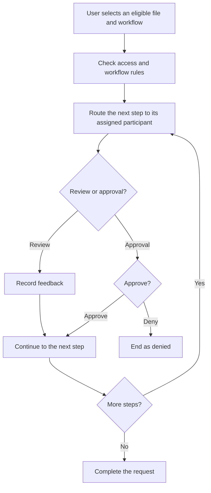
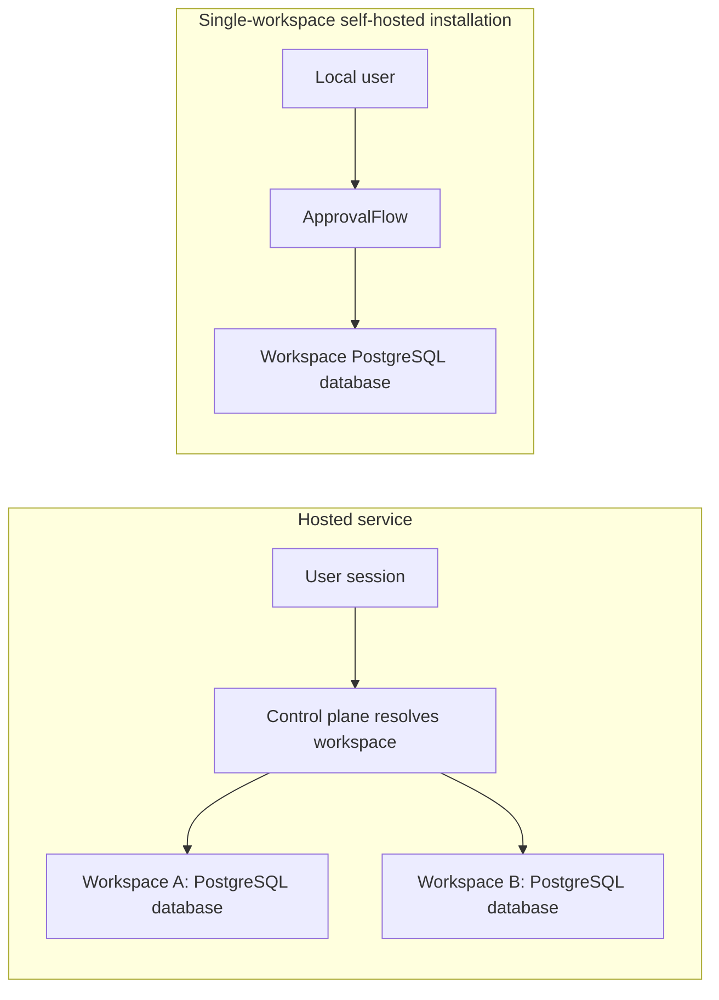

Every two weeks, I met with the client's technical lead for technical and design discussions. Those meetings were where we worked through how a document should move, who should be able to act, and what had to remain true across universities. ApprovalFlow was being shaped for a government institution serving universities. An ordinary user needed to get a document to a decision; the institution needed to see the sequence behind that decision, including who acted and when. Feedback could not be mistaken for approval, and the person starting a request might not know every step the document would need.

The destination was a decision the institution could trace: the file, the people who acted on it, the order of those actions, and the outcome.

<figure class="case-image">
  
  <figcaption>ApprovalFlow sign-in screen</figcaption>
</figure>

## A request follows a defined path

An ordinary user could start from an eligible file and choose an existing, custom, or temporary workflow. Before a request began, the system checked access and workflow rules. Uploads were deduplicated by content hash. Duplicate uploads by the same owner were prevented, and workspace-wide blocking of identical content could be configured. A file already in a request could not quietly become several competing approval processes.

We made review and approval different kinds of step, not different labels for the same action. Informal requests for feedback could be deprioritized; putting review inside the tracked workflow gave it a place in the process without making it the final decision. A reviewer records feedback and the request moves on. An approver can approve or deny, and denial ends the workflow. When a workflow includes approval, validation requires approval to be the final step rather than letting a review close it.

The process stores its ordered steps, assignees, outcomes, annotations, and timestamps. An audit log provides a separate record of events. That supports operational traceability, but does not by itself establish compliance with a particular standard or retention policy.

The order also has to mean something. A step becomes actionable only for its assigned, authenticated participant, and only after its prerequisites are satisfied. At action time, PostgreSQL locks the step and checks that it is still pending. An action against a step that has already advanced is rejected rather than recorded as a second outcome. That makes the workflow state, not a stale screen, the authority.

## The route can change without losing control

The route could still be incomplete. A requester may not know that another review is needed, or an approver may discover a missing step after the request is underway. A fixed workflow would require the request to be rejected or restarted. We allowed a participant with process-modification permission to request an additional review or append steps. That is a bounded exception to the original route: the process can respond to what people learn while it is in progress, without making every participant free to rewrite it.

## Access follows each person's responsibility

As the request moves, each person should see the work they are responsible for, not every file in the workspace. Ordinary users create requests; reviewers and approvers act on assigned steps; managers and auditors have reporting or oversight access. File access is checked through the user's session and relationship to the file or workflow, so a signed file link alone does not grant access.

Dedicated Files and Steps workspaces show the relevant work. Activity records and in-app or email notifications keep participants informed as the request progresses.

## Each workspace has its own data boundary

The institution needed a self-hosted installation for its own work and hosted workspaces for the universities it served. Each workspace needed its own data enclosure. We considered shared-database isolation, including row-level security, but it did not meet the requirement for physical separation. We chose a separate PostgreSQL database per workspace.

In the hosted service, a control plane resolves the workspace from the user's session and routes the request to its database. Identity changes across the control plane and tenant databases are coordinated with rollback and retries. This makes provisioning, routing, and identity synchronization more complex, but the number of universities was finite, so stronger separation mattered more than designing for sharding.

## The document stays usable in the process

People needed to work with documents without leaving the approval flow. PDF and image files could be viewed in ApprovalFlow; Office documents needed editing as well, so we integrated ONLYOFFICE. It receives a JWT-signed, file-specific configuration, with editing explicitly controlled. Docker Compose deploys the application and ONLYOFFICE together. This keeps document work in the process, at the cost of operating an additional service.

Storage had to fit different operating environments too. Files can live on local storage or an S3-compatible service, with tenant-scoped paths and administrator-managed migration between targets. Supporting both makes storage more adaptable, but adds migration and operational work.

## The process leaves evidence of how it moved

Responsiveness was an internal performance measure, so a simple pending or complete status was not enough. Reports derive approval, rejection, and review status; completion duration; monthly throughput; weekday timing; and per-step service-target performance from recorded process steps. Managers can use these measures to examine the work, while auditors have a separate oversight role. The system reports what happened; it does not by itself prove that approval times improved or that a particular compliance standard was met.

ApprovalFlow therefore ends where the request began: with a document that needed a decision. It can pass through assigned review and approval steps, adapt when more scrutiny is needed, and finish with a recorded outcome. The same process keeps access tied to responsibility and data separated by workspace, while giving the institution evidence about how requests are handled.
