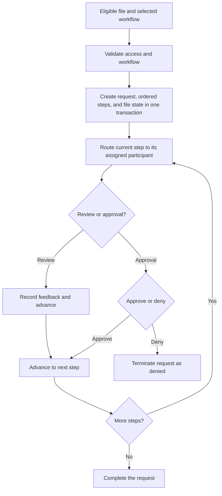
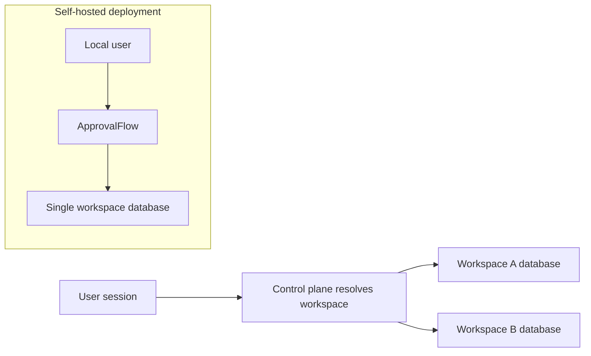
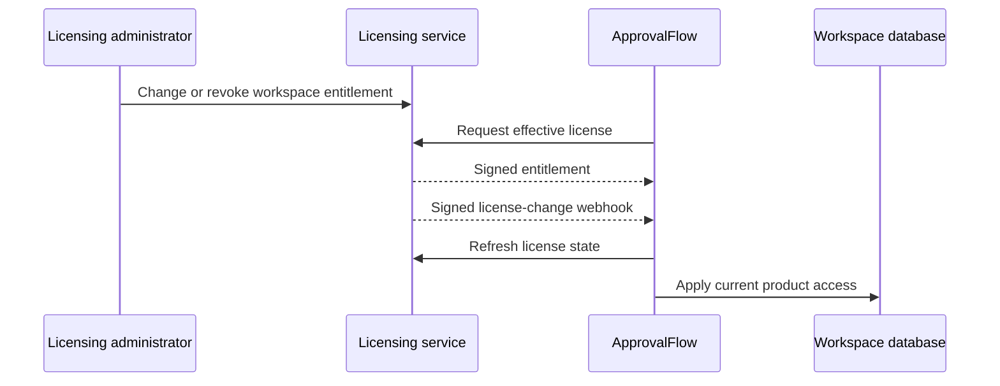

ApprovalFlow had to make document decisions traceable without making workflows brittle. A request needed to preserve who acted and when, distinguish review from authorization, and allow additional steps when a process proved incomplete. I worked through these constraints with the client's technical lead in recurring technical and design reviews, shaping the workflow rules and data boundaries around them.

The architecture separates the approval workflow, workspace data, file authorization, and commercial licensing. Requests advance through explicit states, each workspace owns a separate database, and files remain protected by application-level authorization even when an external editor needs access to them. Licensing sits outside the request path, so entitlement can change independently of workflow state.

<figure class="case-image">
  
  <figcaption>ApprovalFlow sign-in screen</figcaption>
</figure>

A document request is represented as an approval record with an ordered set of process steps. Each step has an assignee, type, outcome, and position. This gives the system a precise account of who may act next and what that action means.

The distinction between review and approval is enforced in the transition rules. A review records feedback and advances the request. An approval can approve or deny; denial ends the workflow. When a workflow includes approval, validation requires an approval step at the end. This reflects the institution's need to gather input without allowing feedback alone to stand in for authorization.

Request creation writes the approval record, its ordered steps, and the file's transition into review in one PostgreSQL transaction. When an assignee acts, the service checks the actor and prerequisites, locks the current step, and confirms that it is still pending before advancing it. If two people submit an action against the same step, the lock and state check allow only the first valid transition. The database, rather than a stale client view, remains authoritative.

The ordered model is deliberately narrower than a general workflow engine. It supports sequential steps and controlled insertion of more work, rather than parallel branches or arbitrary conditional routing. That keeps the path and its outcome straightforward to inspect, while limiting the kinds of process variation the system can represent.

The original sequence cannot anticipate every missing review. Freezing it would require restarting a request when someone discovers a needed step; allowing all participants to rewrite it would weaken accountability.

ApprovalFlow permits a participant with process-modification permission to insert a review or append steps after a request has started. This preserves progress while keeping changes within an explicit permission boundary. The trade-off is that the workflow can evolve during execution, so its final sequence may differ from the one selected at submission.

The institution needed a self-hosted installation for its own work and hosted workspaces for the universities it served. Each workspace required a separate data enclosure. Shared-database isolation, including row-level security, was considered, but did not satisfy the requirement for physical separation.

ApprovalFlow separates workspace routing from workspace data. A control-plane database stores workspace and authentication-routing information. Each workspace has its own PostgreSQL database for operational data. In hosted mode, the control plane resolves the workspace from the user's session and routes the request to that database. Self-hosted mode runs with a single registered workspace.

This makes the tenant boundary clear in the data layer and supports both hosted and self-hosted operation. It also means provisioning databases, running migrations, managing connections, and keeping identity state aligned require more operational work. Some identity updates use coordinated retries and rollback across the control plane and tenant databases; other user-management paths do not use that centralized synchronization service, so consistency handling is not uniform across every path.

Commercial access is managed by a separate licensing service. ApprovalFlow requests the effective license for a client and workspace, then caches the returned entitlement. When the commercial agreement changes, the licensing service can revoke or change that entitlement and send a signed webhook that prompts ApprovalFlow to refresh its license state. This gives the company a way to adjust product access when financial commitments are not met, without making licensing part of each approval transaction.

Separating commercial entitlement from approval state keeps the workflow record focused on document decisions, while licensing remains a company-controlled access boundary. The application also caches license state and can fall back to a cached or default snapshot when refresh fails, so the exact timing and user-visible effect of a revocation depend on the refresh and fallback behavior.

Files are stored locally or in an S3-compatible service through a storage abstraction. Tenant-scoped paths keep files within their workspace. Administrators can migrate files between storage targets, which supports different operating environments without changing the approval model.

Uploads are hashed for deduplication. Duplicate uploads by the same owner are prevented, and workspace-wide blocking of identical content can be configured. These checks happen in application code rather than through a database uniqueness constraint. That keeps duplicate policy configurable, while leaving a race possible if identical uploads arrive simultaneously.

The file record and stored bytes live in different systems, so they cannot be committed in one database transaction. If registering a file fails after storage succeeds, the application attempts to remove the uploaded bytes. This is compensating cleanup rather than an atomic transaction across PostgreSQL and object storage.

For Office documents, ApprovalFlow integrates ONLYOFFICE. It receives a signed, file-specific configuration, while ApprovalFlow continues to check the user's session and relationship to the file when serving it. A signed file token alone does not grant access. This keeps authorization with the application and editing inside the workflow, with the operational cost of running an additional document service.

The same separation applies to notifications. Workflow state is committed to PostgreSQL first. Notification work is queued separately in an outbox, using deterministic identifiers so repeated processing does not create duplicate in-app activity records. This keeps delayed email or notification delivery from changing the recorded approval outcome.

The outbox includes retry state and backoff. The repository does not show a periodic worker that guarantees every pending notification will be replayed, and email failures are logged. In practice, the workflow remains authoritative even when a notification is delayed; notification delivery depends on the outbox processor being invoked.

Because each step and timestamp is recorded, reports can derive approval, rejection, and review status, completion duration, monthly throughput, weekday timing, and per-step service-target performance. Managers can inspect how the process is moving, while auditors have a separate oversight role.

These are measures available from the system's records, not proof of improved approval times or compliance with a particular standard. The architecture makes the process observable; conclusions about performance depend on how the institution uses and interprets that information.

The result is a system in which a document's path is explicit, authorized participants can extend it when necessary, and the resulting decision remains tied to its recorded steps. The architecture makes those guarantees understandable at the workflow and database boundaries, while keeping file storage and notification delivery in supporting roles.
