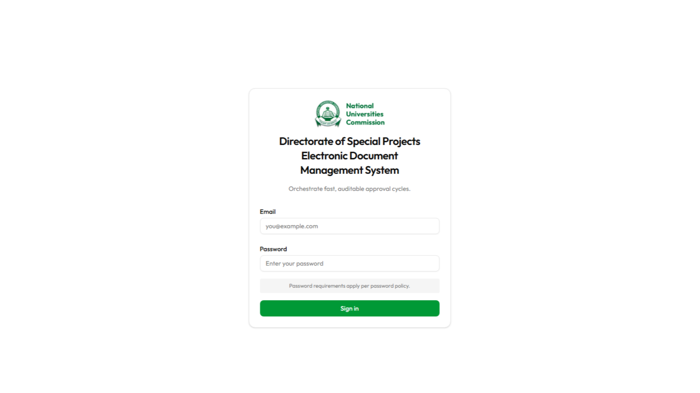

Built for a government institution, ApprovalFlow treats document approval as a process. Requests move through defined review and approval steps, record who acted and when, and can add more review when needed.

<figure class="case-image">
  
  <figcaption>ApprovalFlow sign-in screen</figcaption>
</figure>

## Make feedback visible without making it final

Informal requests for feedback were often deprioritized, but the institution did not want every review to become a final decision. ApprovalFlow puts reviews in the same tracked process as approvals while keeping reviews non-terminal. That makes feedback visible without letting it resolve the request; approval remains a separate decision point. The distinction can be revisited as the institution learns how reviews work in practice.

## Let approvers correct a broken route

Requesters may not know every step a process requires. If the person receiving a request can only approve or deny it, a mistake in the route can stall the process or send it back to the requester. An authorized approver can instead add a reviewer or append steps after the workflow has started. This trades an immutable sequence for correction in place, while permission checks limit who can change the route.

## Make access reflect real responsibilities

A paper and an annual budget do not belong in front of the same people. The institution also had people whose job was to request work and others whose job was to approve it. Exposing every file and action would force users to navigate choices already determined by their responsibilities. ApprovalFlow therefore applies permissions to both files and actions, and presents each role with the work it is meant to handle. This requires more precise access rules than a single generic interface, but reflects how the institution already divided the work.

## Choose database separation over logical isolation

The institution needed an on-premises deployment for its own work and a hosted environment for universities it serves, with each university's data kept separate. Row-level security and logical tenant separation were investigated, but did not meet the requirement for physical separation. ApprovalFlow instead gives each university a separate PostgreSQL database. Because authentication lives in the control plane while work lives in tenant databases, the platform routes each request to the right database and coordinates identity changes with rollback and retries. This adds database and routing work, but the number of universities was finite, so strong separation mattered more than designing for sharding.

## Let storage move with the operating constraints

Budget and operational capacity could change, so the institution wanted to start with local file storage and retain the option to move to cloud storage or back. Supporting only one storage model would make that difficult. ApprovalFlow supports local and S3-compatible storage, with migration between them. The trade-off is maintaining more than one storage path; the result is that the institution can change where files live without specialist work.

## Keep document work inside the workflow

The requested in-platform experience covered PDFs, Office files, images, audio, and video. Built-in support handles PDFs and images, but editing Office documents required a separate capability. ApprovalFlow integrates ONLYOFFICE rather than sending users to another application. That keeps Office editing in the workflow, at the cost of relying on an external document editor.

## Stop duplicate submissions before they trigger work

Users could accidentally submit the same file twice. Once a request starts, a duplicate can notify several people and create unnecessary review work. ApprovalFlow checks file content before the process begins and blocks repeat uploads by the same person. An optional workspace-wide check catches a file already in another approval process, so users can find the existing request instead of starting parallel work. Making that wider check optional lets each workspace choose how broadly to apply the safeguard.

## Turn responsiveness into a measurable signal

Responsiveness was an internal performance measure, but a general status label could not show how quickly work moved. ApprovalFlow records request and step timing and reports turnaround and service-target performance. Managers get concrete timing data for reviews; the product reports the measures without making performance judgments itself.
