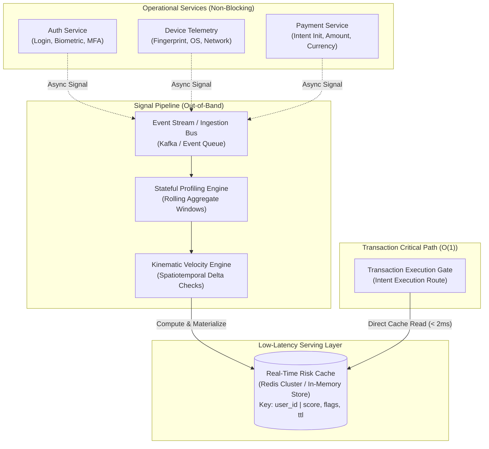
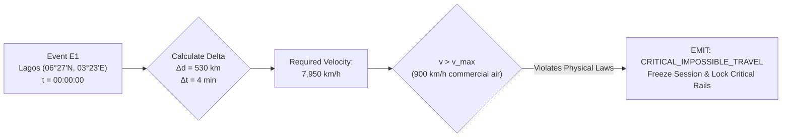

## 1. The Problem

Traditional fraud prevention architectures rely almost exclusively on **synchronous checkpoint inspection**. At the precise moment a user attempts an action (e.g., checkout or funds transfer), execution halts while a monolithic rule engine evaluates the transaction against static parameters.

This checkpoint pattern suffers from severe structural flaws:
1. **The Latency Trap:** Complex behavioral heuristics, IP geolocation lookups, device fingerprint cross-referencing, and graph traversal take hundreds of milliseconds. Placing this processing directly on the critical execution path degrades user conversion and increases checkout failure rates.
2. **Context Isolation:** A checkpoint evaluates the transaction in isolation. It lacks visibility into pre-transaction behavior: the speed of navigation, the geographic trajectory of previous API calls, or subtle session shifts occurring minutes prior to payment.
3. **Stateless Blindness:** Static rule lists cannot detect zero-day account takeovers where valid credentials are submitted from a novel, remote execution environment.

The Continuous Signal Risk Engine resolves these issues by **decoupling signal observation from transaction gating**. Risk evaluation is an asynchronous, ongoing background process that continuously maintains an up-to-date materialized risk profile in hot memory.

---

## 2. Architecture of the Signal Pipeline

The pipeline treats every operational event across the platform as an immutable signal. Telemetry is emitted out-of-band, ingested by an event bus, and aggregated into an active entity profile.



### 2.1 Separation of Concerns

- **Telemetry Ingestion:** Services fire and forget telemetry signals. Signal delivery failure never blocks an upstream operational service.
- **Continuous Recalculation:** The profiling engine evaluates rolling metrics (event frequency, geographic hops, IP subnet volatility, and device changes) across sliding time windows (5 minutes, 1 hour, 24 hours).
- **Downstream Materialization:** As new signals update the user's risk posture, the updated score, classification flags, and confidence bounds are immediately written to the in-memory cache.

---

## 3. Kinematic Spatiotemporal Velocity Detection

Account takeover frequently involves an attacker obtaining an authenticated session token or executing an unauthorized operation from a remote geographic region while the legitimate user's device remains active.

The engine detects this using **Kinematic Delta-Velocity Evaluation** rather than static IP blacklists.

### 3.1 Mathematical Model

When an operational event `E₂` is recorded at time `t₂` with GPS coordinates `(φ₂, λ₂)`, the engine retrieves the prior authenticated event `E₁` at `(t₁, φ₁, λ₁)`.

1. The great-circle surface distance `d(E₁, E₂)` is calculated using the Haversine formula:
   ```text
   a = sin²(Δφ / 2) + cos(φ₁) · cos(φ₂) · sin²(Δλ / 2)
   d = 2R · atan2(√a, √(1 − a))
   ```
   *(where `R` is the Earth's radius, approximately 6,371 km)*.

2. The required travel velocity is evaluated against physical bounds:
   ```text
   v_required = d(E₁, E₂) / (t₂ − t₁)
   ```



If `v_required > v_max` (where `v_max` represents the physical limits of commercial air transit, ~900 km/h), the engine flags an impossible travel violation. This check operates independently of IP spoofing or VPN obfuscation because it evaluates physical GPS coordinate deltas against elapsed wall-clock time.

---

## 4. Zero-Latency Transaction Gating: Cache-First Serving

When a transaction enters the execution boundary (the intent execution route), the transaction processor does not compute risk. It queries the materialized risk cache:

1. **Hot Path (O(1) Cache Hit):**
   - The transaction processor issues a direct lookup: `GET risk:user:{user_id}`.
   - Response latency is < 2ms.
   - If `score <= threshold` and no critical block flags exist, the transaction proceeds to ledger hold reservation.
2. **Cold Path (Cache Miss / Eviction Fallback):**
   - If the user's cache key is cold, the processor executes a synchronous fallback RPC to the profiling engine with a strict 100ms timeout.
   - If the fallback RPC times out, the engine applies a deterministic fail-safe policy: allow low-value transactions within standard daily bounds, but flag for expedited post-settlement audit.

To understand how the Ledger works see [A Ledger's Core Model](/engineering/fintech/ledger/).

---

## 5. Rules

| Rule | Statement | Enforcement |
| :--- | :--- | :--- |
| **Critical-Path Isolation** | Signal ingestion and scoring failures must never prevent upstream services from operating. | Asynchronous messaging decoupling with isolated circuit breakers. |
| **Physical Feasibility** | No account may authorize transactions across geographic distances requiring speeds exceeding physical bounds. | Kinematic Haversine velocity computation on sequential geolocation telemetry. |
| **Sub-5ms Evaluation** | Transaction gating lookups must resolve in < 5ms under standard load. | In-memory key-value materialization of pre-calculated risk profiles. |
| **Credential Cleanliness** | Raw security credentials (passwords, PINs, card CVVs) must never enter the signal stream. | Ingress schema sanitization rejecting prohibited payload fields. |
