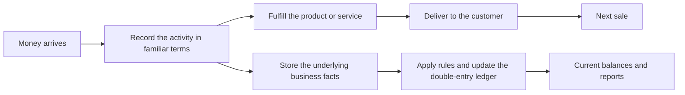
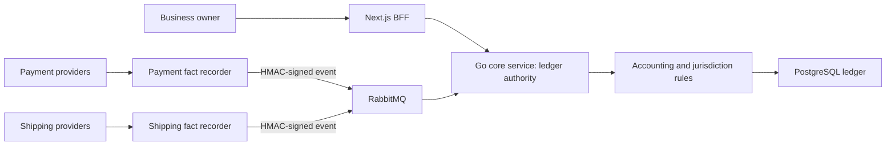

I worked across Kuddle's product decisions and technical implementation. The problem starts in an ordinary business moment: money arrives, but the work is not finished. Someone still has to fulfill the order, coordinate people, deliver the product or service, and keep the books current. For a small team, each new sale can add work while the next customer is already waiting. Kuddle's destination was to connect that operating loop to accurate books without making the owner learn accounting first.

The product fit test was based on the work, not the business's size or industry. If it receives money, fulfills something, and delivers it, Kuddle should help. That could describe a tailor, a retailer, a contractor, or an online seller. The same loop gives the product a clear destination: money recorded, work fulfilled, delivery completed, and the financial position still understandable.

## Keep the books exact without making the owner speak accounting

The owner might know that money is in a particular bank account or that stock was bought for an order. They should not need to understand a chart of accounts to record what happened. We designed the interaction around everyday business language, one decision per screen, resumable work, and quick wins. That is not a simpler accounting model. It is a simpler way into a more exact one.

Kuddle stores business activity as facts, then interprets those facts in the service layer. Every financial event posts through a 19-account, GAAP-aligned double-entry ledger. Monetary values use integer minor units such as kobo or cents, with no floating-point arithmetic in monetary code. Inventory cost is derived from ledger activity instead of stored as an independently editable number. Period-close records are sealed with SHA-256.

That choice costs more to model and maintain than keeping a few editable totals. It gives the business one source for its financial records, so stock cost, sales, and balances do not drift between separate copies of the same number.

## Let country rules change without rewriting the facts

A business's activity can stay the same while the tax rules around it change. Hardcoding one country's currency and classifications into every stored record would make each new jurisdiction a schema problem. Instead, Kuddle stores activity and country facts, then applies jurisdiction-specific rules separately. Tax rules and commercial pricing are also kept apart, so a change in one does not silently change the other.

The rules engine has 30 canonical activity codes and rules for 11 jurisdictions, with each jurisdiction defined in its own Go file. The data model does not need a new tax flag for every market. This creates a path to add or change rules without rewriting historical activity. It does not mean Kuddle is operating in all 11 countries: onboarding is enabled only in Nigeria today.

## Reveal more of the system when the work calls for it

Showing an owner the whole operating system on the first day would add decisions before they had a reason to make them. Kuddle starts with six modules: Money, Relationships, Inventory, Projects, My Office, and Organization. Other modules are visible but locked until actual business activity signals that they are useful. They unlock through business milestones, not a subscription upgrade.

Fifteen background jobs look for patterns in the work and surface them as Insights. The product is meant to reflect what is happening, not lecture the owner or grade the business. This keeps the first experience smaller, at the cost of making some capabilities unavailable until the activity that unlocks them appears.

## Treat payments and shipments as facts before interpreting them

A customer can pay before an order is entered. A carrier can confirm a shipment while the core service is temporarily unavailable. If each payment provider or carrier owned the business record, late or out-of-order events could be lost or force financial state to depend on a vendor's own workflow.

Kuddle separates the recording of an external event from its business meaning. Payment and shipping services record what physically happened, sign the event with HMAC-SHA256, and send it through RabbitMQ. The core Go service is the only service that interprets the event and updates the ledger. A payment with no matching order yet becomes an unattributed inflow until the business record catches up. The fact can still be recorded while the core service is down.

This boundary lets payment and shipping providers change without embedding their SDKs in the ledger service. The system has adapters for four payment providers and seven carrier integrations. The trade-off is asynchronous coordination: the core service has to reconcile facts that may arrive before, after, or independently of the order they relate to.

## Keep each business's records inside its boundary

Once the ledger becomes the source of financial truth, a tenant leak is more than a privacy bug. Kuddle enforces tenant isolation in PostgreSQL with row-level security and separate tenant and system connection pools. Queries are handwritten, parameterized, and compiled with sqlc rather than hidden behind an ORM. Static audits in CI block unsafe query patterns, including inline SQL, problematic RLS subqueries, and hardcoded pagination.

This gives up some ORM convenience and places more responsibility on query authors. In return, tenant boundaries are enforced by the database as well as application code, and query behavior remains explicit. The product also keeps financial data under the business's control: tax and bank information is not shared automatically, no data is sold, and analytics requires consent.

## Fix the delay customers actually experienced

The product's mobile experience is the web app, and a customer using Mobile Safari sent a message saying it felt very slow. That report turned a general complaint into a specific investigation. The team narrowed the issue to iPhone and Safari usage, then changed component rendering and resource loading instead of applying an unfocused optimization across the product.

Standard mobile Largest Contentful Paint improved from 7.8 seconds to 2.4 seconds. In the documented cold 3G test with 20x CPU throttling, it improved from 31.6 seconds to about 10 seconds. Those numbers describe the measured conditions, not every device or network. The experience is still not offline-first; network guards protect form data during dropouts, but do not replace a full offline mode.

The repository records 11 customer-facing releases and eight production postmortems. That establishes shipped product work and a feedback loop, but it does not establish active user counts, revenue, or retention. The evidence supports a system designed to keep a small business's sale, fulfillment, delivery, and books connected, while making clear what has been built and what has not been measured.
