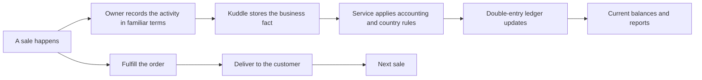
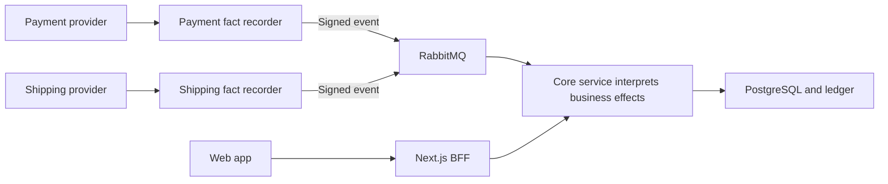

In a small business, a good sales day can create an operations problem. Every new sale adds fulfillment, delivery, and coordination across a small team, pulling attention from customers and making service inconsistent. Kuddle's destination is one connected business loop: record the money, keep the work moving, deliver the product or service, and keep the books accurate without asking owners to learn accounting.

## 1. Start with the work, not an industry label

A bookkeeping tool can record that money arrived, but a small team also has to fulfill the order and get it to the customer. More sales increase that coordination load. Kuddle's fit test is therefore operational: does the business receive money, fulfill something, and deliver it? This lets the product serve different kinds of businesses without defining fit by headcount, revenue, or industry.

## 2. Let owners describe activity; let the system do the accounting

The product brief called for accuracy from day one, but its users were not accounting experts. Asking them to classify journal entries would add cognitive work and introduce another way to make mistakes. Kuddle lets owners record familiar business activity, one decision at a time; the service layer interprets those facts and posts the financial result.

Underneath that simpler interaction is a 19-account double-entry ledger. Amounts use integer minor units rather than floating-point math, and inventory costs come from ledger entries instead of independently edited cost fields. Period-close records are cryptographically sealed with SHA-256. The trade-off is a more demanding financial model behind the interface; the result is exact, traceable accounting without asking owners to operate the ledger themselves.

## 3. Add markets without rewriting recorded activity

Starting with one jurisdiction would have reduced the first release's design work, but it could have tied the product to one country's rules and business habits. The brief required the option to enter another market when the opportunity appeared. Kuddle therefore stores activity as facts and keeps country-specific tax and commercial rules in a separate layer.

That means adding a jurisdiction takes rule code rather than a new interpretation of every stored record. The rules engine contains 11 jurisdictions, but onboarding is currently enabled only in Nigeria. The up-front cost of separating the rules bought optionality; it does not mean the product is live in all 11 markets.

## 4. Introduce capabilities as the business grows

Owners were already overloaded, and onboarding could not usefully explain the whole system at once. Kuddle starts with six modules: Money, Relationships, Inventory, Projects, My Office, and Organization. Additional modules remain visible but locked until business activity shows readiness; access is not sold through paid feature tiers.

The trade-off is that an owner cannot turn on every capability on day one. Instead, the product uses the work already happening to introduce the next tool over time. That makes onboarding and habit-building part of the product, not a one-time tour.

## 5. Keep payment and shipping events flowing

External payment and shipping providers can fail, and the real world does not wait for the software's records to arrive in order. A customer can pay before a cashier enters an order. If provider integrations owned the business state, outages and timing differences could become ledger problems.

Kuddle uses specialized services to record signed payment and shipping facts; the core service alone interprets those facts and updates the ledger. RabbitMQ carries the events between them. This isolates provider failures from the ledger, at the cost of coordinating asynchronous events. A payment received before its order becomes an unattributed inflow until the business record catches up, rather than disappearing because the order was entered later.

## 6. Enforce tenant boundaries where data is stored

Owners use Kuddle to coordinate multi-branch businesses, where data must be fast to enter and retrieve, permissions must hold, and regressions should be caught before release. Application-only filters would place too much responsibility in service code; ORM abstractions would hide query behavior and add reflection overhead.

Kuddle moves tenant filtering into PostgreSQL with row-level security and separate connection pools. Queries are handwritten, parameterized, and compiled with sqlc; static audits in CI block unsafe patterns before deployment. This gives up some of the convenience of an ORM and requires disciplined query work, in exchange for explicit control over performance and database-enforced tenant boundaries.

## 7. Let the business decide what leaves its workspace

Kuddle is designed to change how businesses operate, not to give outside organizations automatic access to their financial activity. Tax or bank data is not shared by default, and analytics requires consent. The trade-off is that external organizations do not receive business data automatically; any sharing remains the owner's decision, including when it could provide value to the business.

## 8. Diagnose slowdowns from evidence

Users repeatedly said the app felt laggy but could not identify the cause. Monitoring and analytics showed that complaints clustered among iPhone users on Safari. Rather than broadly optimizing without knowing the source, the investigation focused on that cohort and changed component rendering and resource loading.

Standard mobile Largest Contentful Paint improved from 7.8 seconds to 2.4 seconds. In the documented cold 3G test with 20× CPU throttling, it improved from 31.6 seconds to about 10 seconds. Those measurements show the result of this investigation under those test conditions.

That is the operating loop Kuddle is built around: a sale moves into fulfillment and delivery while its financial effect enters the same auditable books. As the business grows, new rules and capabilities extend the loop rather than forcing the owner to start again in another system.
