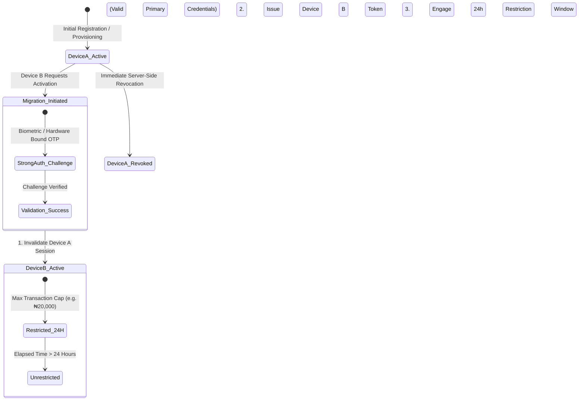
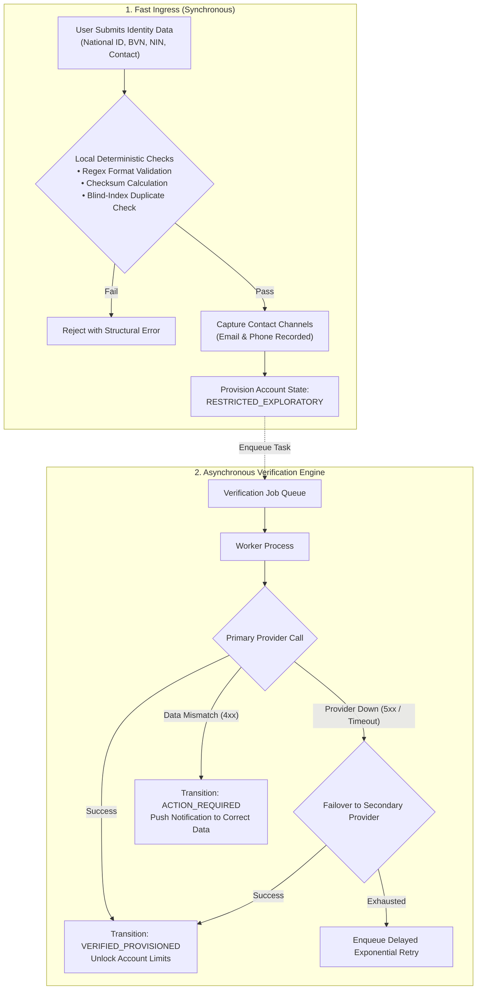
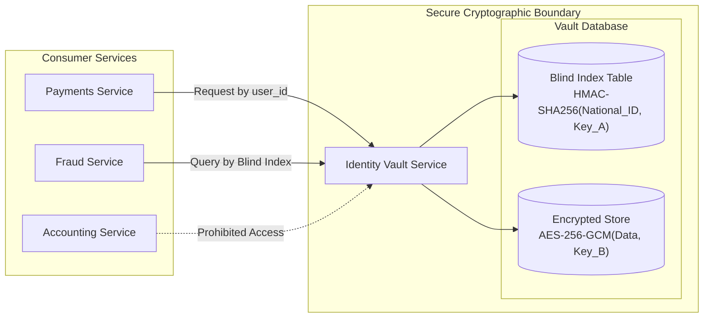

## 1. The Problem

Digital financial platforms routinely suffer from two catastrophic architectural failures in identity management:
1. **The Monolithic Synchronous KYC Gate:** Tying user onboarding directly to synchronous third-party verification APIs (e.g. government identity databases, biometric verifiers). When external upstream providers experience downtime or network latency, onboarding halts completely. The user abandons the process, and the platform retains zero contact metadata to re-engage them.
2. **Multi-Device Session Sprawl:** Permitting authenticated sessions to persist concurrently across multiple physical devices. If a user misplaces an old device or falls victim to SIM-swap token theft, unauthorized actors retain access until the victim manually navigates complex account deactivation menus.

The Device Boundary & Identity Engine resolves these vulnerabilities by enforcing **decoupled asynchronous verification pipelines**, **strict singular device boundaries**, and **isolated cryptographic containment for personally identifiable information (PII)**.

---

## 2. Strict Single-Device Boundary & State Invalidation

A financial application must enforce strict physical device exclusivity. An account may possess exactly one active, authorized device token at any given millisecond.



### 2.1 Invalidation Mechanics

1. **Zero-Grace Revocation:** When Device B completes verified activation, the central authentication store immediately marks Device A's session token as `REVOKED`. Subsequent API requests from Device A receive an immediate `401 Unauthorized` and trigger local secure storage wipe on the client.
2. **Progressive Trust Gating:** Trust is not assumed instantaneously upon migration. A new device operates under a **24-hour progressive trust window**, enforcing:
   - A strict transaction amount cap (e.g., maximum ₦20,000 daily cumulative outflow).
   - Temporary restriction on security credential alterations (password, PIN, and email modifications).
   - Immediate out-of-band notification dispatched to verified recovery contact channels.

---

## 3. Decoupled Asynchronous KYC State Machine

External identity verification providers exhibit high latency and unpredictable availability. The architecture completely decouples client onboarding from synchronous verification.



### 3.1 Onboarding Resilience

1. **Deterministic Local Ingress:** Format, length, check-digit algorithms, and duplicate detection execute locally against indexed data in < 10ms. If valid, the user's primary contact details (phone and email) are persisted immediately.
2. **Exploratory Non-Blocking State:** The user enters an active application session under the `RESTRICTED_EXPLORATORY` tier. They can explore products, view catalogs, and configure preferences, but funds outflow is locked.
3. **Automated Multi-Provider Failover:** Background workers query the primary verification API. If a connection error or 5xx status occurs, the pipeline automatically switches to a secondary standby provider. The user never experiences an interface crash.
4. **Data Capture Guarantee:** Even if all external verification providers experience an extended outage, the platform has successfully captured the user's identity claims and verified communication channels. When providers recover, verification completes without user intervention.

---

## 4. Cryptographic PII Isolation: Single Owner Architecture

Spreading sensitive customer PII (government identity numbers, home addresses, dates of birth) across multiple service databases exponentially expands the blast radius of any compromise.

The platform isolates identity storage within an autonomous **Identity Vault Service**:



### 4.1 Cryptographic Storage Primitives

1. **Single Access Path:** No service other than the Identity Vault possesses direct database credentials to PII tables. All consumers interface via strict internal gRPC APIs with mutual TLS (mTLS).
2. **Blind Indexing for Queryability:** To search for duplicate records (e.g., checking if a National Identity Number is already registered) without storing plain text:
   ```text
   IndexHash = HMAC-SHA256(RawID, IndexKey)
   ```
   Lookups execute against the deterministic HMAC index in O(1) time without decrypting the dataset.
3. **Envelope Encryption at Rest:** PII fields are encrypted using authenticated `AES-256-GCM`. Encryption keys are rotated regularly via hardware security modules (HSM) and decoupled from standard operational database backups.

---

## 5. Rules

| Rule | Statement | Enforcement |
| :--- | :--- | :--- |
| **Strict Device Singularity** | Exactly one active device session token may exist per user account. | Atomic token invalidation in central session store upon new activation. |
| **Non-Blocking Ingress** | External provider outages must never prevent capture of user contact channels. | Asynchronous job queuing with local structural pre-validation. |
| **PII Blast Isolation** | No service outside the Identity Vault may hold unencrypted government identity numbers. | Network and database level access control with blind-index HMAC queries. |
| **Progressive Migration Trust** | Any migration to a novel hardware identifier imposes temporary limits on transaction velocity. | Stateful 24-hour progressive trust window flag on session tokens. |
