## 1. Boundaries and Foundations

### 1.1 The Operational Problem: Pooled Accounts

The ledger is the authoritative record for tracking ownership and movement of money.

Running a separate real bank account for every customer creates too much compliance work and operating cost. Commercial platforms instead use a small number of real bank accounts and track each customer's share of the pooled funds.

The ledger's central problem is to determine **which portion of that pooled money belongs to which account**, without relying on arbitrary balance updates.

The ledger answers this question by recording and aggregating every single movement of money. An account balance is never an arbitrary number; it is the verifiable aggregate of all historical money movements.

The ledger does not need to understand the business meaning of an operation. Shipping, payments, refunds, disputes, and other services use the same primitives.

### 1.2 Boundaries

The ledger sits between business services, physical payment rails, and formal accounting:

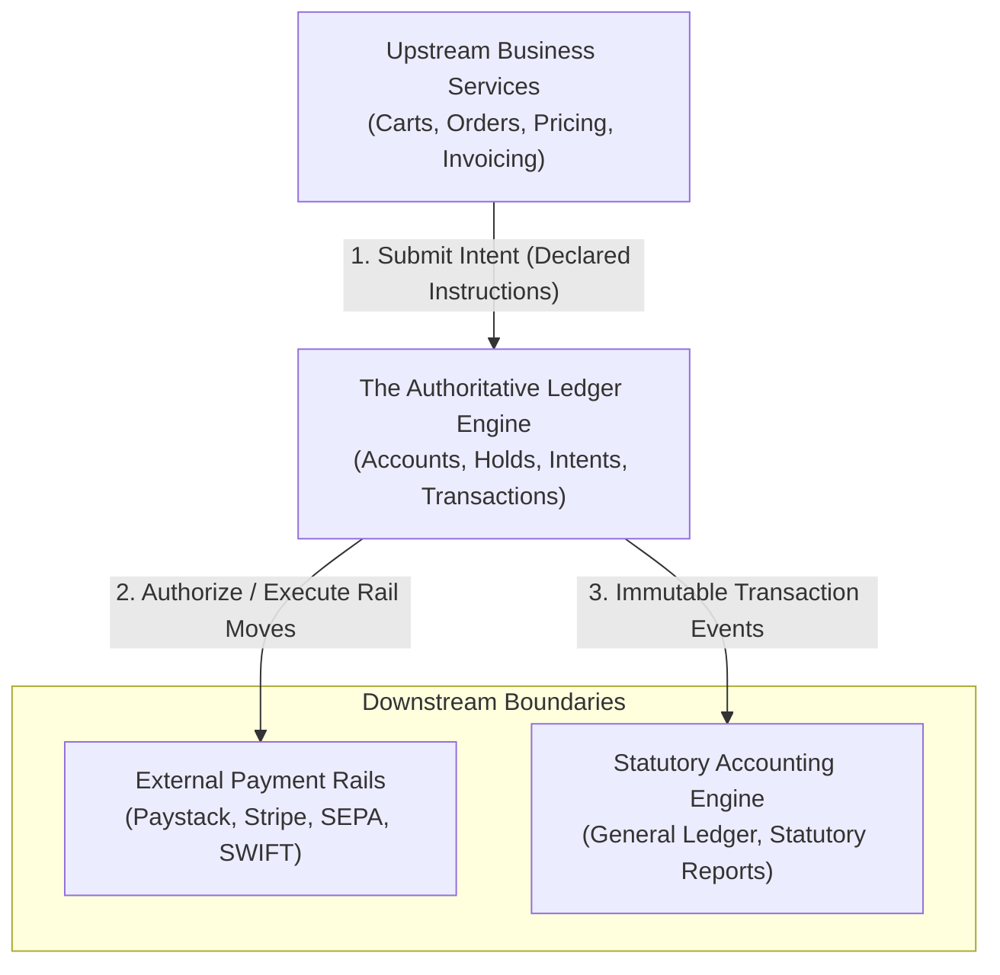

- **Business Services**: Define intent, manage customer carts, set pricing, and initiate operations.
- **The Ledger**: Authoritative record of economic ownership, holds, instructions, and financial obligations.
- **Payment Rails** (e.g. Paystack, Stripe, bank rails): Move physical money through external banking networks.
- **Accounting Engines**: Consume immutable ledger events to generate statutory books and financial reports.

#### The Ledger Should Drive, but It Can Also Ride Shotgun

The platform interacts with the ledger and does not call payment processors directly for payment work.

The ledger operates in one of two modes:

##### 1. Primary Mode (Ledger-First / Autonomous Execution)

The platform submits the Intent to the ledger. The platform does not communicate directly with payment gateways or processors to initiate payments. The ledger orchestrates execution:

1. **Declare and Lock:** The platform calls the intent creation route. The ledger verifies balances against overdraft limits and locks the required funds into `HOLD`.
2. **Rail Dispatch:** The ledger triggers the configured payment processor (such as Stripe, Paystack, or a banking network) to execute the real-world transfer.
3. **External Move:** The payment processor executes the transfer through the physical banking network.
4. **Inbound Webhook Callback:** Upon rail completion, the payment processor fires a standard webhook callback directly to the ledger.
5. **Settlement Signal:** The incoming webhook serves as the settlement signal:
   - **On Success:** The ledger executes settlement transactions, disbursing funds from `HOLD` to destination accounts (`HOLD → Destination`).
   - **On Failure:** The ledger executes a reversal, releasing locked funds from `HOLD` back to the source account (`HOLD → Source`).
6. **Platform Notification:** The ledger records the state change and emits an outbox event to inform the platform of the outcome.

The payment processor requires no knowledge of double-entry rules or ledger internals. It only reports rail success or failure, which acts as the ledger's trigger to settle or reverse.

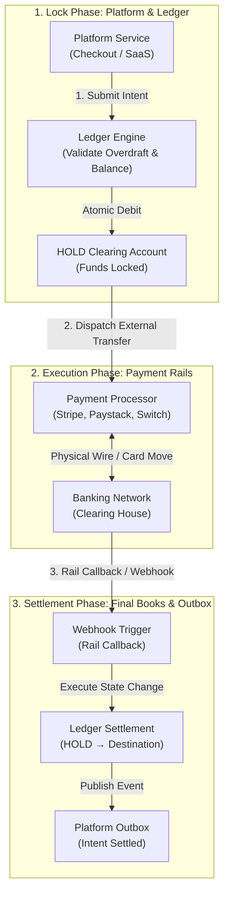

##### 2. Downstream Mode (Payment-First / Atomic Execution)

The ledger can also operate downstream when real-world payments complete outside first (such as an external point-of-sale terminal, a third-party checkout widget, or an incoming rail event).

In this mode, the platform submits the Intent with `"settle": true` or an inline settlement array. The ledger validates accounts and executes both the hold and settlement atomically within a single database transaction.

### 1.3 Foundational Axioms & The Central Principle

The ledger is built on three basic rules:

> **1. Every request to move money is an Intent.**
>
> **2. A Hold is an internal clearing account used to stage committed funds, keeping every transaction strictly between two accounts.**
>
> **3. Money is neither created nor destroyed, only transferred. However, accounts can be unbounded.**

From these axioms emerge the four core primitives of the ledger universe:

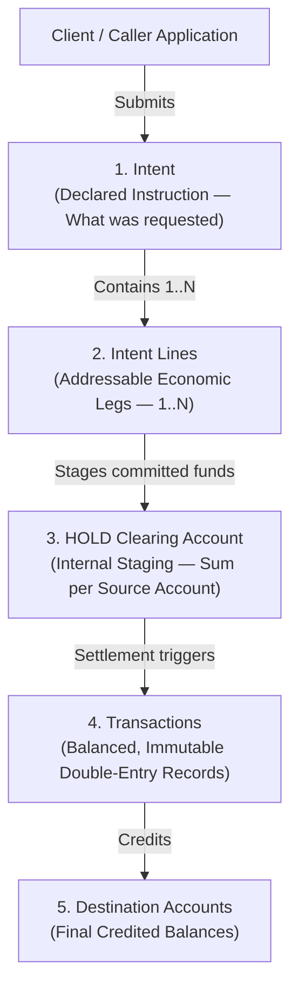

- **`Intent`**: What the caller asked the ledger to do. Immutable, declared upfront, containing Intent Lines.
- **`Intent Line`**: One fixed leg of an instruction, addressable by `line_id` for incremental settlement.
- **`Transaction`**: What the ledger actually executed. Immutable, double-entry balanced, generated by the ledger.
- **`Hold`**: An internal clearing account used to stage committed funds until settlement or reversal.

---

## 2. Core Entities & Primitives: Where Money Lives

Before money can move, it must have a place to live.

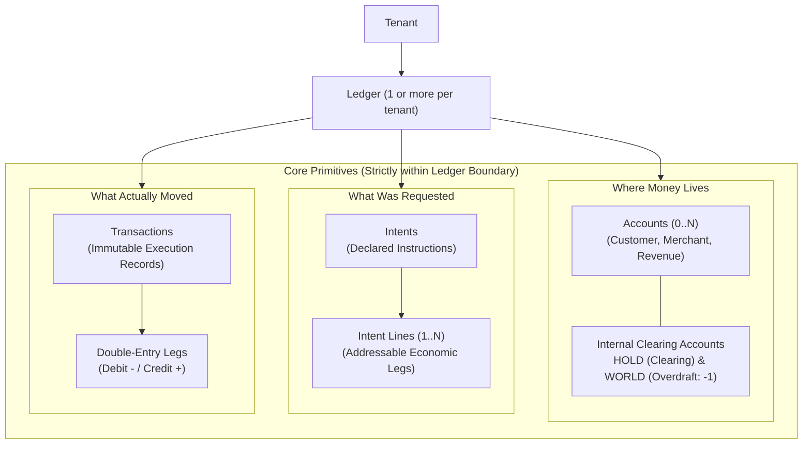

**Cardinality:** A Tenant has at least one Ledger, and may have as many as it needs (e.g. one per currency, one per business unit, however the tenant chooses to partition its books). A Ledger can hold any number of Accounts. Nothing below the Ledger level crosses Ledger boundaries: an Intent Line's source and destination Accounts must belong to the same Ledger.

### 2.1 Accounts

An Account represents available monetary value.

`Account.balance` is strictly derived from immutable transaction history. The ledger derives balance dynamically (combining immutable snapshots with indexed hot transactions), ensuring zero dual-write discrepancy without requiring callers to replay history manually.

| Account Type | Business Purpose | Normal Balance | Allowed Overdraft |
| :--- | :--- | :--- | :--- |
| `CUSTOMER` | End-user balances and stored wallet value | >= 0 | Typically `0` |
| `PROVIDER` | Merchant or service partner payout balances | >= 0 | Typically `0` |
| `REVENUE` | Platform fee and commission balances | >= 0 | Typically `0` |
| `CLEARING` | Intermediary staging accounts for funds in transit | Transient | Controlled by operational policy |
| `SUSPENSE` | Temporary holding accounts for disputed or unallocated funds | Variable | Controlled by operational policy |
| `HOLD` | Internal staging of committed funds | >= 0 | Always `0` (ledger controlled) |
| `WORLD` | Bridge to external banking universe | Variable | `-1` (unbounded overdraft) |

### 2.2 Built-in Clearing Accounts: HOLD and WORLD

Every Ledger automatically initializes with two built-in clearing accounts upon creation:

1. **`HOLD`**: An internal clearing account. The ledger uses it to stage committed money until settlement or reversal. It is not a customer wallet, and customers do not see it.
2. **`WORLD`**: The bridge between internal ledger accounting and external banking rails. It represents the external financial universe.

### 2.3 Overdraft Limits & Unbounded Accounts

Every Account has an `overdraft_limit` field that governs how far its balance can drop below zero:

- **Non-negative Integer (`>= 0`)**: Specifies the maximum minor units the account may overdraw.
  - `overdraft_limit = 0`: Standard account. No overdraft permitted. `Account.balance` cannot drop below `0`.
  - `overdraft_limit = 200000`: For an NGN account, allows drawing down up to `-200,000` kobo (representing ₦2,000).
- **Special Sentinel (`-1`)**: Represents **unbounded overdraft**. The account has no floor and can absorb negative balances without limit.

The built-in clearing account `WORLD` is configured with `overdraft_limit = -1` (unbounded). When funds enter the ledger from external payment rails (deposits), money moves from `WORLD` to an internal account (`WORLD → Account A`). When funds exit to external banking rails (withdrawals or payouts), money moves from the account to `WORLD` (`Account A → WORLD`).

> **Rule: Overdraft Bounds**
> An Account's balance cannot fall below `-Account.overdraft_limit`, unless configured with `-1` (unbounded overdraft, e.g. `WORLD`). Any operation that would breach this floor is rejected.

### 2.4 Monetary Units

All monetary amounts in the ledger are integers, expressed in **minor units** of the currency (e.g. kobo for NGN, cents for USD/EUR). There is no other option. A request that sends a decimal or fractional amount is rejected outright, not rounded or coerced.

- **Currency is defined once, at Account creation, and is immutable for that account.** An Account's currency never changes.
- **Currency must be a valid ISO 4217 alphabetic code** (e.g. `NGN`, `USD`, `EUR`). Account creation rejects anything else.
- **Minor unit calculations**: In NGN, 1 Naira = 100 kobo (so ₦2,000 = `200000` kobo). In USD/EUR, 1 unit = 100 cents (so €4.30 = `430` cents).
- **The ledger does not store a minor unit exponent per currency.** Minor units are the universal convention across the ledger.
- **Every amount, in every direction, is minor units.** Intent Line amounts (`source_amount`, `destination_amount`), settlement amounts, Hold amounts, Transaction amounts, and Account balances are all minor units. Converting to a human-readable major-unit display is entirely a presentation concern for the client.

---

## 3. Movement Primitives: Transactions, Double Entry, and Conservation

Now that accounts exist to hold value, how does money move between them?

### 3.1 Transactions: What Actually Happened

A Transaction is an **actual financial movement** performed by the ledger.

Every Transaction must reference an Intent. A Transaction cannot exist independently of an Intent. Posted Transactions are immutable: once written, they can never be modified or deleted.

> **Rule: Intent Mandate**
> Every Transaction references an Intent. No money moves outside an Intent.
>
> **Rule: Transaction Immutability**
> Posted Transactions are immutable. They are never edited or deleted.

### 3.2 Double-Entry Balancing

Double entry applies to **each individual Transaction**.

Every Transaction moves money from a source account to a destination account. Both legs must balance:

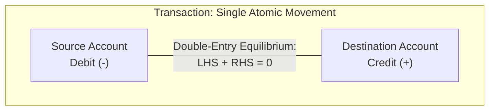

Inside the ledger, every Transaction balances to zero on its own:

```text
Balance = LHS + RHS = 0
```

Double entry is a property of each Transaction, not of an instruction as a whole.

> **Rule: Double-Entry Equilibrium**
> Every Transaction satisfies double-entry balancing (`LHS + RHS = 0`). Net balance across all accounts is zero:

```text
Net Balance = Sum of all Account.balance = 0
```

### 3.3 The Law of Conservation and Unbounded Accounts

> **Money is neither created nor destroyed, only transferred. However, accounts can be unbounded.**

Because every Transaction is a balanced pair, the net sum of all balances across a closed Ledger is always zero.

Money enters and exits the closed ledger through accounts with unbounded overdraft:

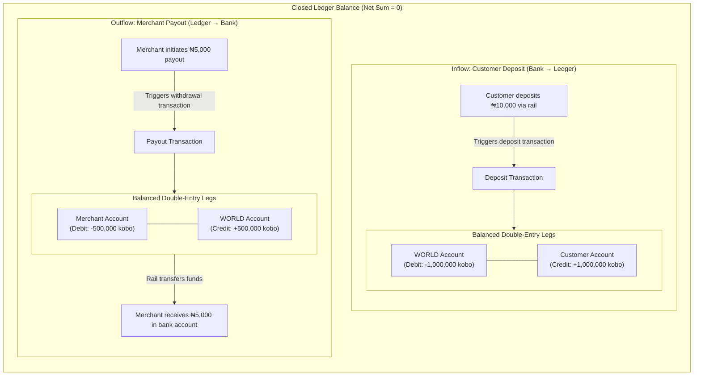

| Lifecycle Step | WORLD Balance | Customer Balance | Merchant Balance | Net Balance |
| :--- | :--- | :--- | :--- | :--- |
| **1. Initial State** | `0` | `0` | `0` | **`0`** |
| **2. Deposit (+₦10,000)** | `-1,000,000` | `+1,000,000` | `0` | **`0`** |
| **3. Commerce Movement** | `-1,000,000` | `+500,000` | `+500,000` | **`0`** |
| **4. Payout (-₦5,000)** | `-500,000` | `+500,000` | `0` | **`0`** |

- When a customer deposits ₦10,000 (1,000,000 kobo) from an external payment rail, the ledger executes:
  ```text
  Transaction: WORLD → Customer Account    1,000,000 (kobo)
  ```
  Customer balance becomes `+1,000,000`. `WORLD` balance becomes `-1,000,000`. Double-entry balance remains exact: `+1,000,000 + (-1,000,000) = 0`.
- When a merchant withdraws ₦5,000 (500,000 kobo) to a physical bank account:
  ```text
  Transaction: Merchant Account → WORLD    500,000 (kobo)
  ```
  Merchant balance decreases by `500,000`. `WORLD` balance increases toward zero.

Customer and revenue accounts stay strictly bounded by their configured balances and limits, while the `WORLD` account absorbs external inflows and outflows.

### 3.4 Cross-Currency Transactions

A Transaction's source and destination accounts are not required to share a currency.

When currencies differ, the amount leaving the source and the amount arriving at the destination are denominated in their respective minor units:

```text
Transaction: Source Account (NGN) → Destination Account (EUR)
Source: -200,000 (NGN minor units: 200,000 kobo = ₦2,000)
Destination: +430 (EUR minor units: 430 cents = €4.30)
```

The Transaction remains a single, atomic, balanced movement. The ledger does not perform floating-point exchange rate calculations; the amounts for both legs are fixed by the instruction that generated the Transaction.

### 3.5 Atomicity and Database Transactions

Financial operations are **atomic** (all-or-nothing).

Placing money on hold, settling funds, and executing corrective movements require multiple state updates:
1. Verify available balance against overdraft limits.
2. Debit the source account balance.
3. Credit the destination account balance.
4. Record the immutable Transaction entry.

All steps execute within a single **database transaction**. If any step fails or violates a constraint, the database transaction rolls back completely, leaving no partial state.

> **Rule: Operation Atomicity**
> Hold, settle, reversal, and refund operations execute atomically within a database transaction.
>
> **Rule: ACID Boundary**
> All financial state changes occur within a database transaction.

---

## 4. Instruction Primitives: Intents and Intent Lines

Transactions record what actually happened. But how does the ledger know what movements to execute?

### 4.1 Intents: What the Caller Wants to Do

An Intent represents the immutable financial instruction submitted to the ledger.

An Intent answers: "What does the caller want the ledger to do?"

When a client creates an Intent, the ledger validates the instruction and returns a permanent `intent_id`. The client uses this ID for all subsequent operations and never needs to resubmit the instruction.

The Intent itself does not have a stored status column. Its status is derived dynamically from the Transactions posted against it.

> **Rule: Instruction Immutability**
> Every Intent instruction (including all Intent Lines) is immutable once created.

### 4.2 Intent Lines: Complete Leg Specification

An Intent contains one or more **Intent Lines**. An Intent Line describes one fixed leg of an instruction: a movement of value from a specific source to a specific destination.

Every Intent Line must specify four core fields alongside its identifier, all in minor units:

| Field | Type | Description |
| :--- | :--- | :--- |
| `line_id` | String | Client-assigned unique identifier for the line. |
| `source_account` | String | Identifier of the account to debit. |
| `source_amount` | Integer | Integer minor-unit amount to debit from the source. |
| `destination_account` | String | Identifier of the account to credit. |
| `destination_amount` | Integer | Integer minor-unit amount to credit to the destination. |

```json
{
  "description": "Payment for order #1042",
  "lines": [
    {
      "line_id": "li_1",
      "source_account": "user_xyz",
      "source_amount": 200000,
      "destination_account": "provider_2",
      "destination_amount": 200000
    },
    {
      "line_id": "li_2",
      "source_account": "user_xyz",
      "source_amount": 50000,
      "destination_account": "shipping_revenue",
      "destination_amount": 50000
    }
  ]
}
```

The full set of Intent Lines is fixed at creation and immutable. Nothing about what the money does is decided after creation; only when each declared leg executes is flexible.

### 4.3 Currency Evaluation (Handling Multi-Currency)

The ledger does not handle exchange rates; it performs **currency evaluation**.

The ledger maintains no exchange rate tables and contains no dynamic conversion engine. When an Intent Line is evaluated, the ledger checks:

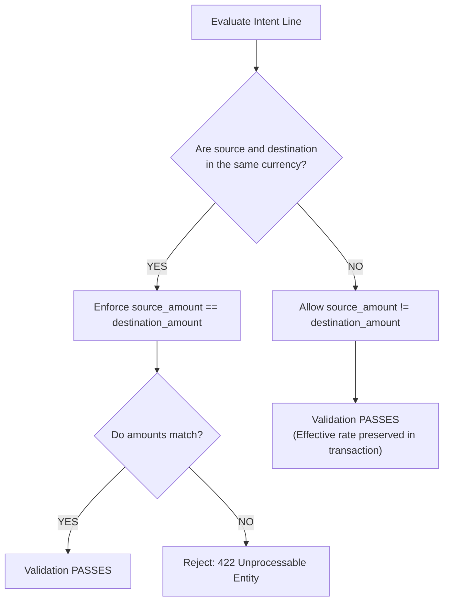

1. **Same-Currency Evaluation:**
   - Are `source_account` and `destination_account` denominated in the same currency?
   - **If YES**: `source_amount` and `destination_amount` **must be identical** (`source_amount == destination_amount`). If they differ, the ledger rejects the request with `422 Unprocessable Entity`.
2. **Different-Currency Evaluation:**
   - **If NO**: The ledger permits `source_amount` and `destination_amount` to differ.

#### Modeling a Real-World Cross-Border Product

Consider a cross-border remittance service where customer `user_ngn` pays ₦2,000 (200,000 kobo NGN) to send Euros to a recipient outside the ledger on European payment rails, while the platform works with an external FX liquidity partner:

```json
{
  "description": "Cross-border remittance to external EUR recipient",
  "lines": [
    {
      "line_id": "li_remit_eur",
      "source_account": "user_ngn",
      "source_amount": 185000,
      "destination_account": "WORLD",
      "destination_amount": 400
    },
    {
      "line_id": "li_fx_spread",
      "source_account": "user_ngn",
      "source_amount": 10000,
      "destination_account": "platform_fx_revenue_ngn",
      "destination_amount": 10000
    },
    {
      "line_id": "li_partner_fee",
      "source_account": "user_ngn",
      "source_amount": 5000,
      "destination_account": "rails_partner_clearing_ngn",
      "destination_amount": 5000
    }
  ]
}
```

| Line ID | Description | Source Account | Source Amount | Destination Account | Destination Amount | Implied Rate |
| :--- | :--- | :--- | :--- | :--- | :--- | :--- |
| `li_remit_eur` | External EUR payout | `user_ngn` | `185,000` kobo | `WORLD` | `400` cents | 462.50 NGN/EUR |
| `li_fx_spread` | Platform FX margin | `user_ngn` | `10,000` kobo | `platform_fx_revenue_ngn` | `10,000` kobo | 1.00 (Same currency) |
| `li_partner_fee` | Rail clearing fee | `user_ngn` | `5,000` kobo | `rails_partner_clearing_ngn`| `5,000` kobo | 1.00 (Same currency) |
| **Total** | **Customer Commitment** | `user_ngn` | **`200,000` kobo** | — | — | **₦2,000 total debited** |

In this single Intent instruction:
- **`li_remit_eur`**: Cross-currency payout to an external recipient. Because the recipient sits outside the ledger on external banking rails (e.g. SEPA transfer), the destination account is the built-in account `WORLD`. The ledger permits `185000` kobo (NGN) to leave `user_ngn` and `400` cents (€4.00 EUR) to exit the ledger to `WORLD`.
- **`li_fx_spread`**: Same-currency line. The platform retains ₦100 (10,000 kobo) as its foreign exchange spread revenue. Because both accounts are NGN, amounts must match (`10000 == 10000`).
- **`li_partner_fee`**: Same-currency line. The platform allocates ₦50 (5,000 kobo) to cover the external banking rail partner fee. Amounts must match (`5000 == 5000`).

#### How the Rate Gets Saved Without Caring About Rates

Notice how the ledger processes this:
1. **Hold evaluation**: The ledger sums all source amounts for `user_ngn`: 185,000 + 10,000 + 5,000 = 200,000 kobo (₦2,000). It places 200,000 kobo on hold.
2. **Settlement**: When executed, €4.00 exits the ledger to `WORLD` for external payout, 10,000 kobo lands in platform FX revenue, and 5,000 kobo lands in partner clearing.
3. **Historical rate auditability**: When querying the Intent later, any client or auditor can calculate the effective exchange rate backwards:

```text
Effective Rate = line.source_amount / line.destination_amount
               = 185,000 kobo / 400 cents
               = 462.5 NGN/EUR
```

### 4.4 Architectural Principles of Conversions and Exchange Rates

Operating cross-currency financial products requires clear boundaries between quoting, conversion, and ledger recording:

1. **Upstream Rate Locking:**
   The platform or business service locks exchange rates and quotes them to the customer **before** creating the Intent. The ledger never queries live currency tickers or calls exchange rate APIs. The agreed rate is frozen directly into the `source_amount` and `destination_amount` fields of the Intent Lines.

2. **Integer Minor Units Without Floating-Point Math:**
   Currency multiplications frequently produce fractional subunits. All rounding and truncation rules execute upstream in the platform business logic. The ledger accepts only whole integers in minor units, preventing floating-point drift and rounding discrepancies across ledgers.

3. **Rate Immutability (No Dynamic Revaluation in the Core Ledger):**
   Once an Intent is created, its declared lines and amounts are immutable. If market exchange rates fluctuate while an Intent is pending or partially settled, the Intent Lines do not change. The ledger records the economic agreement established at the time of instruction. Any subsequent accounting revaluations (such as unrealized FX gain/loss adjustments) are performed via separate, explicit adjustment transactions, never by editing existing records.

4. **Decomposed Spread Modeling:**
   Commercial platforms rarely execute bare conversions. They decompose a cross-border transaction into distinct economic legs:
   - The principal payout leg (`WORLD` in foreign currency),
   - The platform FX margin leg (`REVENUE` in domestic currency),
   - The third-party rail fee leg (`CLEARING` in domestic currency).
   This allows the platform to reconcile revenue and fees cleanly in local currency while fulfilling international payouts.

---

## 5. Operational Lifecycle: Intent → Hold → Settle

With accounts, transactions, and intents defined, value moves through the ledger using the fundamental operational pattern:

> **Intent  ───>  Hold  ───>  Settle**

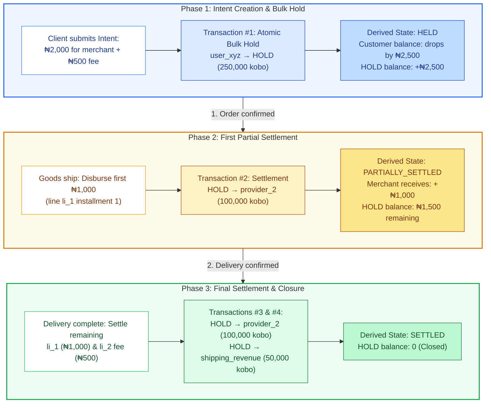

### 5.1 The Platform Agreement (Before the Ledger)

Before calling the ledger, terms are agreed on the platform:
1. Customer `user_xyz` agrees to pay ₦2,000 (`200000` kobo) to merchant `provider_2`.
2. Platform fee is ₦500 (`50000` kobo).
3. Total customer commitment: ₦2,500 (`250000` kobo).
4. Business service submits the Intent to the ledger via the intent creation route.

### 5.2 The Hold Step: Staging Committed Funds

A Hold is an internal ledger account (a clearing account). The ledger uses it to stage committed money until settlement or reversal. Customers do not see it, keeping double-entry pure.

To understand what to hold, the ledger inspects all Intent Lines and aggregates all `source_amount` values, **grouped strictly by `source_account`**.

The hold has **nothing to do with destination accounts or destination amounts**. What is held from each source account is simply the sum of its declared source amounts:

```text
Hold Amount for source_account = Sum of line.source_amount across all lines for this source_account
```

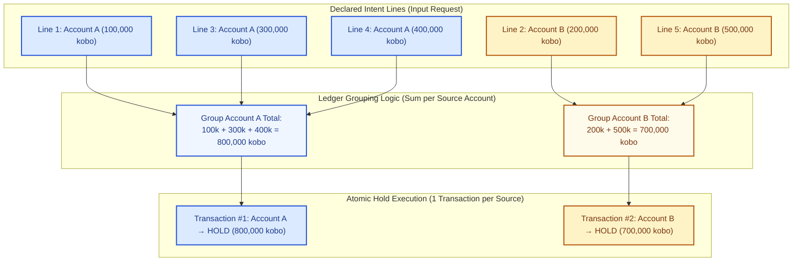

If an Intent contains multiple source accounts, the ledger executes one Hold transaction per source account:
- If `account_1` has source amounts across three lines (e.g. 100,000 + 300,000 + 400,000 = 800,000 kobo), the ledger executes:
  ```text
  Transaction: account_1 → HOLD    800,000 kobo
  ```
- If `account_2` has source amounts across two lines (e.g. 200,000 + 500,000 = 700,000 kobo), the ledger executes:
  ```text
  Transaction: account_2 → HOLD    700,000 kobo
  ```

In our checkout example with single source account `user_xyz`:
```text
200,000 (Line 1) + 50,000 (Line 2) = 250,000 kobo (₦2,500)
```

The ledger executes:

```text
Transaction #1: user_xyz → HOLD    250,000 kobo
```

Available balance of `user_xyz` drops by 250,000 kobo. The funds sit securely in `HOLD`.

Placing funds on hold is an actual ledger Transaction that covers the Intent's total across all Intent Lines for that source account.

> **Rule: Hold Solvency**
> A Hold cannot draw more funds than the source account has available under its configured `overdraft_limit`.

An open Hold has no expiry. It persists until settled or explicitly reversed.

### 5.3 The Settlement Model

Settlement is where destination accounts come in. Settlement is how funds are disbursed to their final destination accounts per Intent Line.

Nothing new is decided at settlement time. Settlement controls only:
1. **Which** Intent Lines execute now vs. later, and
2. **How much** of each Intent Line's destination amount executes in this call.

#### The `settlement` Array

Settlement is submitted via the intent settlement route with a `settlement` array:

```json
{
  "settlement": [
    { "line_id": "li_1", "amount": 100000 }
  ]
}
```

**`amount` is always denominated in the destination account's currency (minor units).** Here, `100000` kobo represents disbursing ₦1,000 of the ₦2,000 owed to `provider_2`.

#### Universal Validation Rule for Settlement

For each entry in the settlement array:

```text
Settlement Amount <= line.destination_remaining

where:
line.destination_remaining = line.destination_amount - Sum(posted settlement amounts for line_id)
```

Because every settlement entry is checked against `line.destination_amount`, over-settlement is structurally impossible.

> **Rule: Settlement Ceiling**
> For any Intent Line, cumulative settled value cannot exceed `line.destination_amount`.

When a settlement entry executes, the ledger posts the settlement transaction directly from `HOLD` to the destination account:

```text
Transaction #2: HOLD → provider_2    100,000 kobo
```

### 5.4 Integration Workflows: Autonomous (Ledger-First) vs. Downstream (Atomic)

A core strength of the ledger architecture is its universal symmetry: every money movement is an Intent, and every Intent can execute in either of two operational patterns depending on whether the ledger executes autonomously in front or downstream:

#### Pattern A: Autonomous Execution / Ledger-First (The Standard Pattern)
Use this workflow when the ledger sits ahead of external payment rails or physical delivery:
1. **Hold Placed:** The platform submits the Intent without a settlement array. The ledger validates balances and locks the committed money into `HOLD`.
2. **External Execution:** The ledger triggers external payment rails (e.g. card network, bank transfer, crypto rail) or awaits physical dispatch.
3. **Webhook Signal & Staged Settlement:** When the payment service confirms success via webhook, the settlement route disburses funds from `HOLD` to destination accounts. If the operation fails externally, the ledger cancels the hold via reversal without touching destination accounts.

#### Pattern B: Downstream Execution / Payment-First (Atomic Settlement Workflow)
Use this workflow when physical money movement has already completed outside the ledger (e.g. an external card processor webhook, a POS terminal swipe, or an atomic internal wallet transfer):
1. **Submit with Inline Settlement:** The platform submits the Intent and includes the `settlement` array directly in the request body.
2. **Atomic Execution:** By including the settlement array at creation, the caller informs the ledger: "This transaction has already happened. Record the full transaction and execute both the hold and the settlement immediately."
3. The Hold transaction and all matching Settlement transactions execute atomically within a single database transaction.

```json
{
  "description": "Immediate checkout (Payment-First / Atomic)",
  "lines": [
    {
      "line_id": "li_1",
      "source_account": "user_xyz",
      "source_amount": 200000,
      "destination_account": "provider_2",
      "destination_amount": 200000
    }
  ],
  "settlement": [
    { "line_id": "li_1", "amount": 200000 }
  ]
}
```

#### Settling Later (Staged Invocations)
When using the Ledger-First pattern, the client calls the intent settlement route as external confirmations arrive:

```json
{
  "settlement": [
    { "line_id": "li_1", "amount": 100000 },
    { "line_id": "li_2", "amount": 50000 }
  ]
}
```

This can be called repeatedly for subsets of lines and partial amounts until every line's `destination_remaining` reaches zero.

### 5.5 Hold Closure

The Hold closes once every Intent Line's remaining unsettled amount reaches zero, whether through settlement, reversal, or refund.

---

## 6. Correcting Mistakes: Reversals and Refunds

An immutable ledger never edits, modifies, or deletes past records. All balance corrections execute as automated **internal counter-Intents**.

### 6.1 The Principle of Internal Counter-Intents

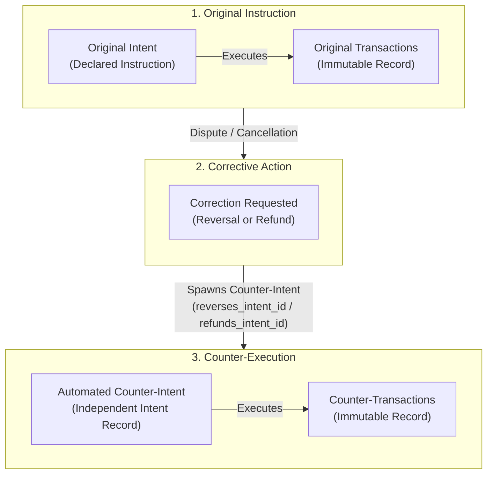

- Rather than modifying past records or updating balances in place, the ledger generates an internal counter-Intent.
- Corrections are first-class financial records. Nothing is deleted.

> **Rule: Counter-Intent Integrity**
> Reversal and refund counter-Intents are automated, first-class financial instructions. They generate immutable Transactions that preserve full double-entry balance and route all money strictly through Hold accounts.

### 6.2 The Money Route on Refunds: Everything Flows Through HOLD

A fundamental rule of this ledger is that **money never transfers directly between accounts, it moves through a Hold account**.

When money was originally paid from `user_xyz` to `provider_2`:
1. **Hold Stage:** `user_xyz → HOLD` (locked funds).
2. **Settlement Stage:** `HOLD → provider_2` (disbursed funds).

When a refund occurs, the ledger does not create a direct shortcut `provider_2 → user_xyz`. Doing so would bypass the clearing account and violate the two-party rule.

Instead, **everything flows through HOLD**:

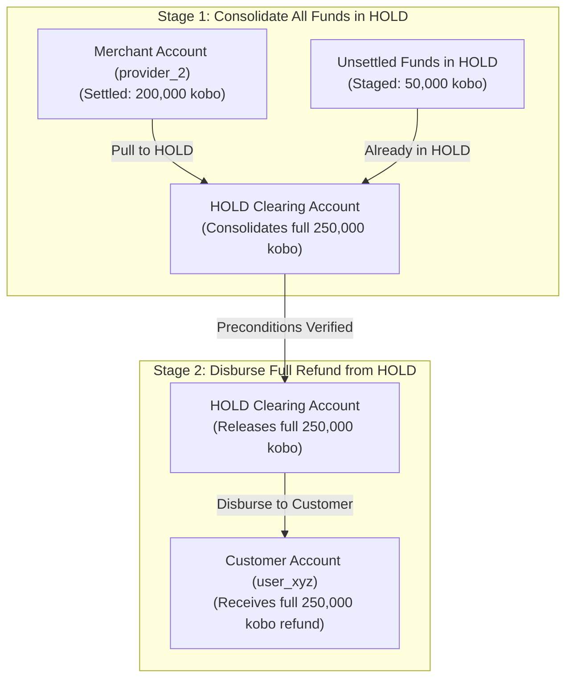

1. **Pull Settled Funds into HOLD:**
   The ledger pulls the settled funds back from the destination account into `HOLD`:
   ```text
   Transaction #R1: provider_2 → HOLD    200,000 kobo
   ```
2. **Consolidate in HOLD:**
   The money that was already settled (200,000 kobo) is now in `HOLD`. Any money from the original Intent that never settled (50,000 kobo) is already in `HOLD`. `HOLD` now contains the full 250,000 kobo.
3. **Disburse from HOLD to Source Account:**
   When the refund settles, the ledger disburses the full refund amount from `HOLD` back to the customer:
   ```text
   Transaction #R2: HOLD → user_xyz      250,000 kobo
   ```

No money ever skips `HOLD`. Every transaction remains strictly between an individual account and a clearing account.

### 6.3 Counter-Intent API & The Optional Settle Payload

Callers trigger reversals and refunds using dedicated lifecycle routes: the reversal route and the refund route.

#### Request Payload Structure
Both endpoints accept an **optional** JSON request body:

```json
{
  "settle": false
}
```

- **Default Behavior (`"settle": false` or omitted `{}`):**
  If the body is empty or `"settle"` is omitted, the ledger defaults to `false`.
- **When `"settle": false` (Staged / Ledger-First Refund):**
  - The ledger creates the counter-Intent and executes the Hold stage: it pulls the settled funds from `provider_2` into `HOLD`.
  - The funds remain locked in `HOLD`.
  - The platform instructs the external payment rail to issue the customer refund.
  - When the payment rail confirms completion via webhook, the platform calls the settlement route against the counter-Intent, disbursing `HOLD → user_xyz`.
- **When `"settle": true` (Atomic / Payment-First Refund):**
  - The caller signals that the refund has already completed externally, or that this is an immediate balance adjustment.
  - The ledger executes both the Hold stage (`provider_2 → HOLD`) and the Settle stage (`HOLD → user_xyz`) atomically within a single database transaction.

### 6.4 Decision Logic: Reversal vs. Refund

Reversal and refund are strictly **Intent-level operations**. The client supplies the target intent identifier and an optional `{"settle": boolean}` body:
- No manual `line_ids`
- No manual calculations of refund legs

The ledger inspects the original Intent and its complete Transaction history to verify preconditions and construct the corrective movements.

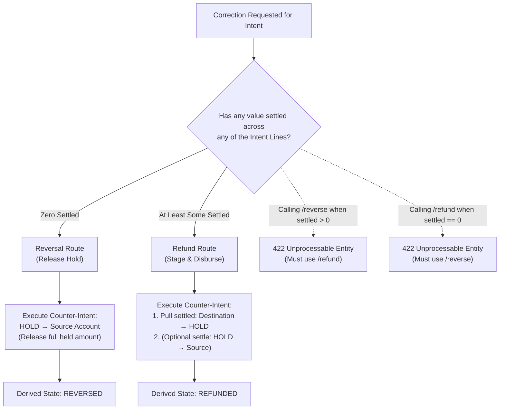

| Property | Reversal Route | Refund Route |
| :--- | :--- | :--- |
| **Precondition** | Exactly 0 settled value across all lines | > 0 settled value across lines |
| **Settled Funds Action** | None (nothing settled) | Destination → `HOLD` (pull back to clearing) |
| **Held Funds Action** | `HOLD` → Source (release full hold) | `HOLD` → Source (disburse consolidated hold) |
| **Execution Route** | Strictly via `HOLD` (`HOLD → Source`) | Strictly via `HOLD` (`Dest → HOLD → Source`) |
| **Request Payload** | Optional `{ "settle": boolean }` (defaults to `false`) | Optional `{ "settle": boolean }` (defaults to `false`) |
| **Derived State** | `REVERSED` | `REFUNDED` |
| **Rejection Rule** | Rejected (`422`) if any line has settled | Rejected (`422`) if zero lines have settled |

### 6.5 Reversal Details

A reversal cancels an Intent when **none of its value has settled**.

- **Precondition:** Zero value settled across all Intent Lines.
- **Rejection:** If any value has settled, the reversal route is rejected with `422 Unprocessable Entity`. Callers must use the refund route.
- **Mechanic:** Because nothing settled, all funds reside in `HOLD`. The ledger constructs an internal counter-Intent that releases the hold back to the source account:
  ```text
  Original Hold:   user_xyz → HOLD    250,000 (kobo)
  Reversal:        HOLD → user_xyz    250,000 (kobo)
  ```
- If `"settle": true` is provided (or when the reversal settlement executes), the held money returns to `user_xyz` within the database transaction.

### 6.6 Refund Details

A refund undoes an Intent when **at least some value has settled**.

- **Precondition:** At least some value settled across Intent Lines.
- **Rejection:** If zero value has settled, the refund route is rejected with `422 Unprocessable Entity`. Callers must use the reversal route.
- **Mechanic:** The ledger examines the Transaction history and constructs a single internal refund counter-Intent:
  1. **Hold Stage:** Pulls settled funds from the destination into `HOLD`:
     ```text
     Transaction #R1: provider_2 → HOLD    200,000 kobo
     ```
  2. **Consolidation:** The remaining held value from the original Intent (50,000 kobo) remains in `HOLD`. `HOLD` now holds 250,000 kobo.
  3. **Settlement Stage:** Disburses from `HOLD` to the customer:
     ```text
     Transaction #R2: HOLD → user_xyz      250,000 kobo
     ```
  - When `"settle": true`, both transactions commit atomically in one database transaction.
  - When `"settle": false` (default), Transaction #R1 commits immediately, and Transaction #R2 executes when the settlement signal is received.

### 6.7 Core Rule Summary

> **A reversal releases held money. A refund stages settled money back into HOLD and releases everything in HOLD to the source.**

### 6.8 Traceability

Records are permanently linked via audit fields:
- **Reversals:** Original Intent references `reversed_by_intent_id`; counter-Intent references `reverses_intent_id`.
- **Refunds:** Original Intent references `refunded_by_intent_id`; counter-Intent references `refunds_intent_id`.

---

## 7. Derived Intent State

Intent state is derived dynamically from the Transactions posted against the Intent and its Hold:

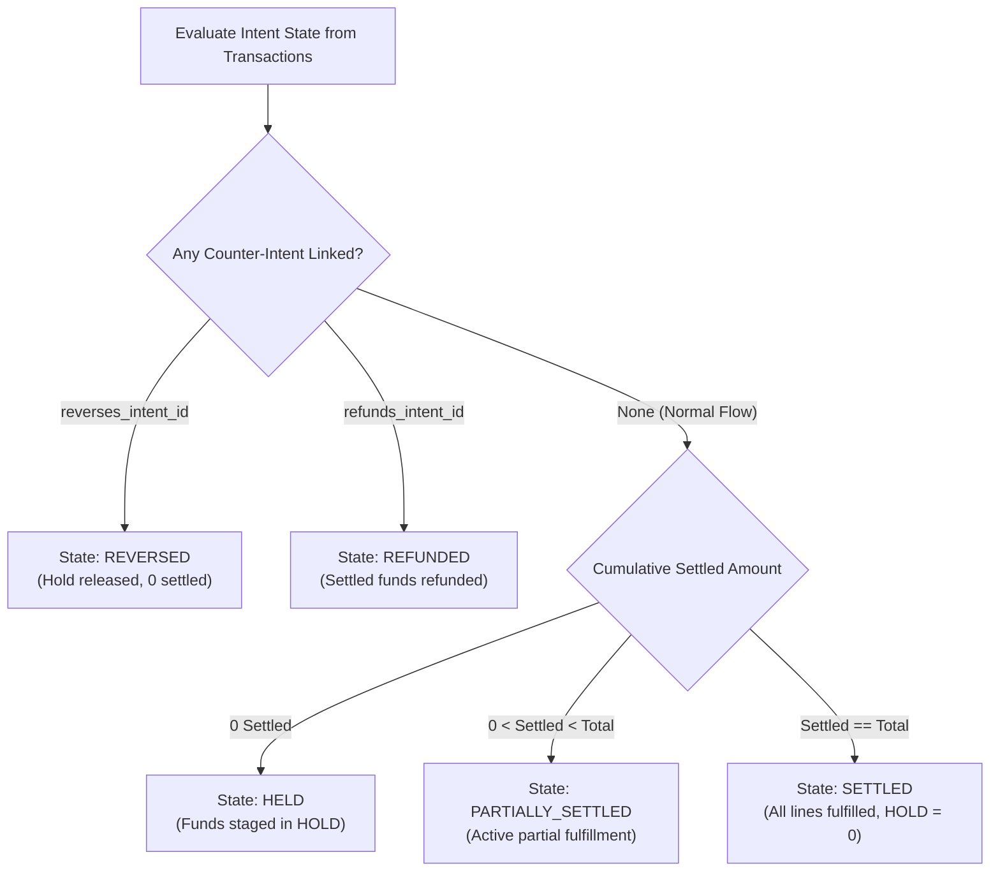

| Derived State | Precondition on Hold Transaction | Precondition on Settlement Transactions | Counter-Intent Linkage |
| :--- | :--- | :--- | :--- |
| `HELD` | Hold transaction posted | Cumulative settled amount == 0 | None |
| `PARTIALLY_SETTLED` | Hold transaction posted | 0 < Cumulative Settled < Total Declared | None |
| `SETTLED` | Hold transaction posted | Cumulative settled amount == Total Declared | None |
| `REVERSED` | Hold transaction posted | Cumulative settled amount == 0 | `reversed_by_intent_id != null` |
| `REFUNDED` | Hold transaction posted | Cumulative settled amount > 0 | `refunded_by_intent_id != null` |

```text
Intent #123
└── Transaction: user_xyz → HOLD (250,000 kobo)
=> HELD

Intent #123
├── Transaction: user_xyz → HOLD (250,000 kobo)
└── Transaction: HOLD → provider_2 (li_1, partial: 100,000 kobo)
=> PARTIALLY_SETTLED

Intent #123
├── Transaction: user_xyz → HOLD (250,000 kobo)
├── Transaction: HOLD → provider_2 (li_1, full: 200,000 kobo)
└── Transaction: HOLD → shipping_revenue (li_2, full: 50,000 kobo)
=> SETTLED

Intent #123
├── Transaction: user_xyz → HOLD (250,000 kobo)
└── reversed_by_intent_id: intent_rev_01
    └── Transaction: HOLD → user_xyz (250,000 kobo release)
=> REVERSED

Intent #123
├── Transaction: user_xyz → HOLD (250,000 kobo)
├── Transaction: HOLD → provider_2 (li_1, settled: 200,000 kobo)
└── refunded_by_intent_id: intent_ref_01
    ├── Transaction: provider_2 → HOLD (200,000 kobo pulled to clearing)
    └── Transaction: HOLD → user_xyz (250,000 kobo full refund release)
=> REFUNDED
```

The database does not maintain a mutable `intent.status` column. The execution history determines the derived state.

---

## 8. Consolidated Rules Matrix

Before introducing external presentations and HTTP routes, this matrix brings together the 11 immutable guarantees that govern the ledger domain:

| Rule | Primitive | Core Guarantee | Breach Trigger |
| :--- | :--- | :--- | :--- |
| **1. Intent Mandate** | Transaction | Every Transaction references an Intent. No money moves outside an Intent. | Internal engine constraint |
| **2. Instruction Immutability** | Intent | Every Intent instruction (including all Intent Lines) is immutable once created. | Mutation attempted on posted intent |
| **3. Overdraft Bounds** | Account | An Account balance cannot fall below `-Account.overdraft_limit` unless configured with `-1` (unbounded). | Balance floor breach (`422`) |
| **4. Operation Atomicity** | ACID | Hold, settle, reversal, and refund operations execute atomically within a database transaction. | Any step failure rolls back all |
| **5. Transaction Immutability** | Transaction | Posted Transactions are immutable. They are never edited or deleted. | Internal database engine constraint |
| **6. Double-Entry Equilibrium** | Ledger | Every Transaction balances to zero (`LHS + RHS = 0`). Net balance across all accounts is zero. | LHS + RHS != 0 rejected |
| **7. Settlement Ceiling** | Settlement | For any Intent Line, cumulative settled value cannot exceed `line.destination_amount`. | `amount > destination_remaining` (`422`) |
| **8. Hold Solvency** | Hold | A Hold cannot draw more funds than the source account has available under its overdraft limit. | Insufficient available balance (`422`) |
| **9. Mutation Idempotency** | API Transport | All mutating operations are idempotent via `Idempotency-Key`. | Key collision with different body (`409`) |
| **10. ACID Boundary** | Persistence | All financial state changes occur within a database transaction. | Non-transactional update rejected |
| **11. Counter-Intent Integrity** | Corrections | Reversal and refund counter-Intents are automated, first-class financial instructions. | Manual balance edits rejected |

---

## 9. Client Views vs. Internal Records

### 9.1 Client Transaction History

From the client's perspective, the unit of financial interaction is the Intent.

A client's account statement is a list of Intents:

```json
{
  "intent_id": "intent_123",
  "description": "Payment for order #1042",
  "amount": 250000,
  "amount_settled": 200000,
  "status": "partially_settled",
  "created_at": "2026-09-09T14:30:00Z"
}
```

The `status` and `amount_settled` presented to clients are computed projections. Clients do not need to parse internal double-entry mechanics.

| Dimension | Client View | Internal Ledger Record |
| :--- | :--- | :--- |
| **Primary Unit** | Intent | Transaction |
| **Movement Structure** | High-level business description | Balanced double-entry pair (`Account → HOLD` / `HOLD → Account`) |
| **Status Field** | Computed status (`partially_settled`, etc.) | Derived from posted immutable transactions |
| **Clearing Accounts** | Hidden (Clients never see `HOLD` or `WORLD`) | Visible and audited |
| **Amounts** | Major units formatted for UI presentation | Minor units integers strictly preserved |

### 9.2 Internal Ledger Records

Internal Transactions and Holds provide the authoritative audit log for financial reconciliation:

```text
Intent #123
│
├── Transaction #1: user_xyz → HOLD: 250,000 kobo (₦2,500)
├── Transaction #2: HOLD → provider_2: 100,000 kobo (₦1,000, li_1 installment 1)
└── Transaction #3: HOLD → provider_2: 100,000 kobo (₦1,000, li_1 installment 2)
```

Internal Transactions are immutable ledger records, accessible for auditing and debugging.

---

## 10. Core API, Idempotency, and Rejection Semantics

### 10.1 Core Operations & Route Architecture

Operations are structured across functional domains (Intents, Accounts, and Audit) without binding the architectural specification to specific URL path implementations:

| Domain | Operation / Route | Operation Type | Purpose | Payload Body |
| :--- | :--- | :--- | :--- | :--- |
| **Intents** | Create Intent | Mutation | Declare instruction & place hold | Full Intent specification |
| **Intents** | View Intent | Query | View intent details & derived state | None |
| **Intents** | Settle Intent | Mutation | Disburse funds from Hold to destinations | `settlement` array |
| **Intents** | Reverse Intent | Mutation | Release held funds (zero settled) | Optional `{ "settle": boolean }` (defaults to `false`) |
| **Intents** | Refund Intent | Mutation | Counter-move settled funds & release hold | Optional `{ "settle": boolean }` (defaults to `false`) |
| **Accounts**| Create Account | Mutation | Open account with currency & overdraft | Account creation payload |
| **Accounts**| List Accounts | Query | List tenant accounts | None |
| **Accounts**| View Account | Query | View account details | None |
| **Accounts**| Query Balance | Query | Query available balance | None |
| **Accounts**| List Transactions | Query | Client-facing intent statement | None |
| **Audit**   | List Holds | Audit Query | Internal holds audit list | None |
| **Audit**   | View Hold | Audit Query | Internal hold details | None |
| **Audit**   | View Transaction | Audit Query | Audit record of actual ledger transaction | None |

### 10.2 Accounts API Specification

#### Account Creation Route

Opens a new account within a specific ledger.

**Headers:**
- `Content-Type: application/json`
- `Idempotency-Key: <unique-string>`

**Request Payload:**

```json
{
  "account_id": "user_xyz",
  "ledger_id": "ledger_retail_ngn",
  "currency": "NGN",
  "type": "CUSTOMER",
  "overdraft_limit": 0,
  "metadata": {
    "user_id": "usr_9921",
    "tier": "tier_1"
  }
}
```

| Field | Type | Required | Description |
| :--- | :--- | :--- | :--- |
| `account_id` | string | No | Unique client-supplied identifier within the tenant and ledger. If omitted, the ledger generates an identifier (`acc_...`). |
| `ledger_id` | string | Yes | The target ledger containing this account. |
| `currency` | string | Yes | ISO 4217 3-letter currency code (e.g. `NGN`, `USD`, `EUR`). Immutable after creation. |
| `type` | string | Yes | Account category: `CUSTOMER`, `PROVIDER`, `REVENUE`, `CLEARING`, or `SUSPENSE`. |
| `overdraft_limit` | integer | No | Maximum allowed negative minor units (`>= 0`). Defaults to `0`. Use `-1` for unbounded overdraft. |
| `metadata` | object | No | Optional arbitrary key-value pairs for client platform integration. |

**Response (HTTP 201 Created):**

```json
{
  "account_id": "user_xyz",
  "ledger_id": "ledger_retail_ngn",
  "currency": "NGN",
  "type": "CUSTOMER",
  "balance": 0,
  "overdraft_limit": 0,
  "status": "ACTIVE",
  "metadata": {
    "user_id": "usr_9921",
    "tier": "tier_1"
  },
  "created_at": "2026-09-10T11:00:00Z"
}
```

**Operational Rules:**
- **Zero Starting Balance:** Every new account derives initial `balance = 0` because it has zero transactions. Money cannot be credited at creation time. Initial funding must occur through a balanced Intent (e.g., `WORLD → user_xyz`).
- **Currency Immutability:** An account's currency is fixed upon creation and cannot be modified.
- **Built-in Accounts Excluded:** Built-in clearing accounts (`HOLD` and `WORLD`) are initialized automatically with the ledger and cannot be created, modified, or deleted via this endpoint.

### 10.3 Idempotency

Every mutating operation (intent creation, settlement, reversal, refund, account creation) requires an `Idempotency-Key` header, scoped **per operation**:

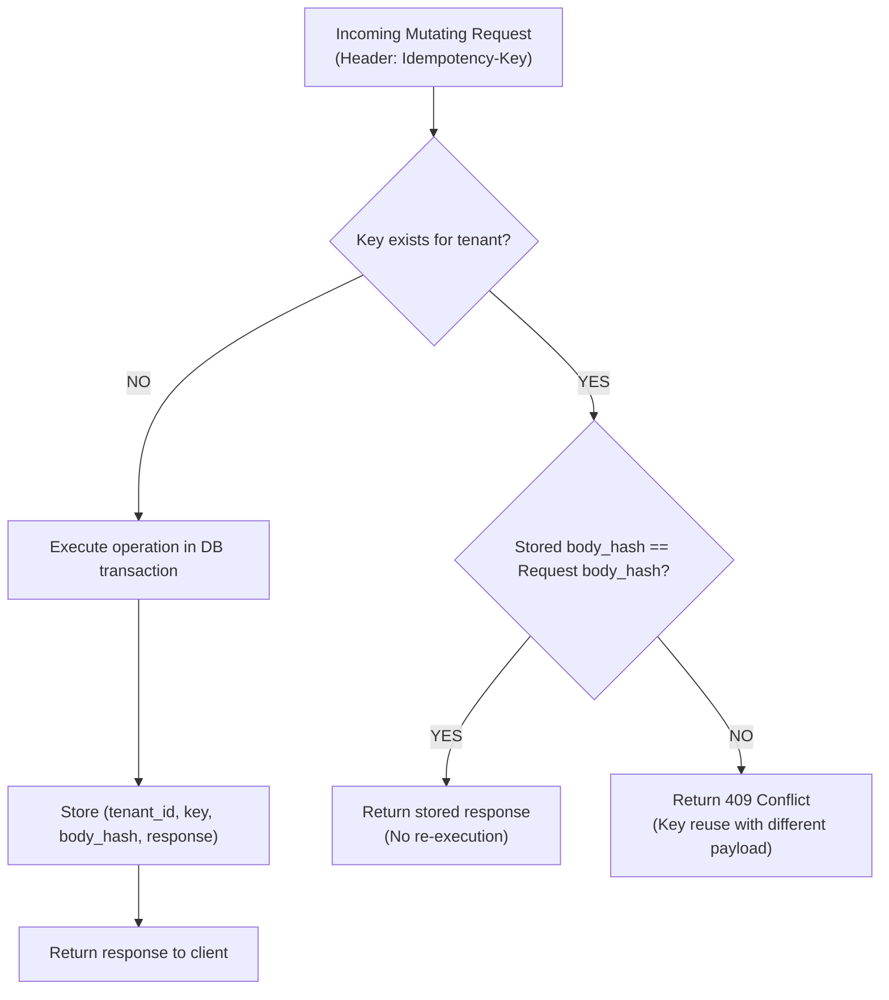

- `(tenant_id, key) → (request_body_hash, response)` is persisted on first receipt.
- For operations with optional bodies (`/intents/reverse/:id`, `/intents/refund/:id`), an empty body or payload hash is paired with the key.
- **Same key + same hash**: Return stored response without re-executing.
- **Same key + different hash**: Return `409 Conflict`.
- Unkeyed retries risk creating duplicate Intents.

> **Rule: Mutation Idempotency**
> All mutating operations are idempotent via `Idempotency-Key`. Retrying an operation with the same key returns the exact same result without duplicate state changes.

### 10.4 Rejection Semantics

Every mutating request is fully validated before writing to persistence. A rejected request touches zero state:

| Failure Trigger | Condition | HTTP Status | Ledger State Impact |
| :--- | :--- | :--- | :--- |
| **Missing line fields** | Missing source/destination account or amounts | `422 Unprocessable Entity` | None (Rejected before write) |
| **Same-currency mismatch** | Source and destination currency match but amounts differ | `422 Unprocessable Entity` | None |
| **Unknown `line_id`** | Settlement array references nonexistent line | `422 Unprocessable Entity` | None |
| **Duplicate `line_id`** | Multiple entries for same line in one settlement array | `422 Unprocessable Entity` | None |
| **Amount exceeds ceiling** | `amount > line.destination_remaining` | `422 Unprocessable Entity` | None |
| **Zero or negative amount** | Non-positive amount in lines or settlement | `422 Unprocessable Entity` | None |
| **Insufficient balance** | Account balance cannot satisfy hold given `overdraft_limit` | `422 Unprocessable Entity` | None |
| **Cross-ledger lines** | Accounts belong to different Ledgers | `422 Unprocessable Entity` | None |
| **Premature refund** | Calling the refund route when settled value is `0` | `422 Unprocessable Entity` | None |
| **Late reversal** | Calling the reversal route after value has settled (> 0) | `422 Unprocessable Entity` | None |
| **Nonexistent ledger** | Account creation references unknown `ledger_id` | `422 Unprocessable Entity` | None |
| **Invalid currency** | Non-ISO-4217 or unsupported currency string | `422 Unprocessable Entity` | None |
| **Invalid overdraft limit** | `overdraft_limit < -1` or non-integer | `422 Unprocessable Entity` | None |
| **Duplicate account ID** | Account ID already exists in ledger | `409 Conflict` | None |
| **Idempotency collision** | Reusing key with different request payload | `409 Conflict` | None |
