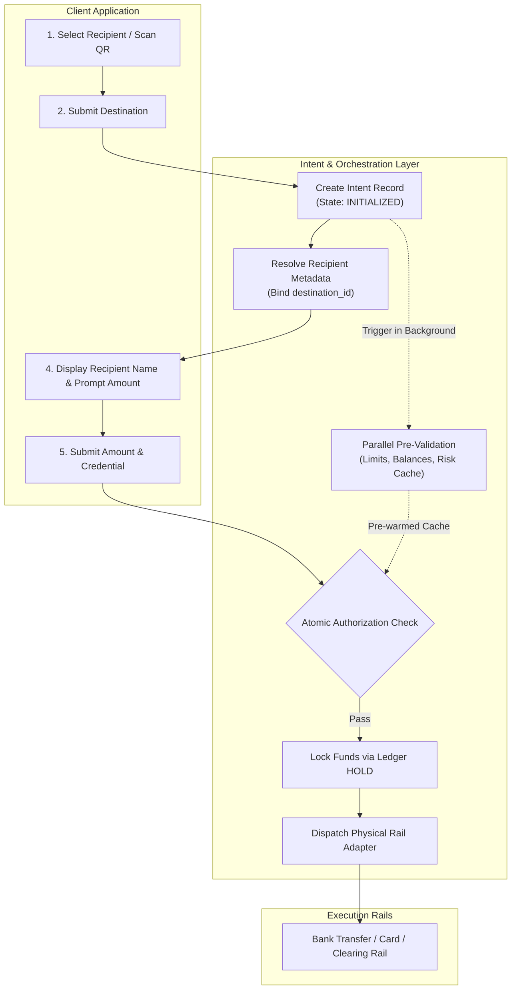
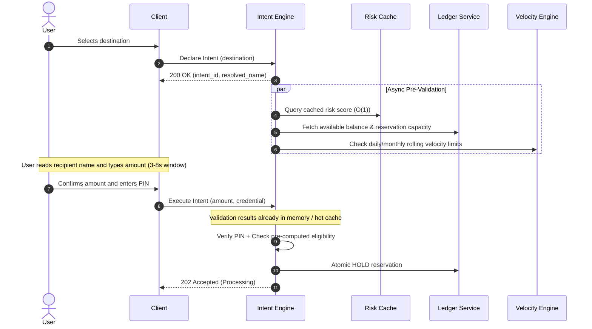

## 1. The Problem

Traditional payment systems often mix two different steps: **choosing what payment to make** and **actually sending the money**.

When an application couples intent declaration with immediate execution, several architectural failures emerge:
1. **Separate payment flows:** Transfers, QR payments, bills, and contactless transactions often use separate rules and records, even though they need the same core checks.
2. **Slow confirmation:** Balance checks, fraud checks, recipient checks, and spending limits run while the user waits to confirm, adding avoidable delay.
3. **Risk of duplicate payment:** Without a single payment ID created before the amount is final, a network timeout can make a retry uncertain.

The Payment Intent Architecture resolves these failures by decoupling the declaration of where money is going from the commitment of how much is transferred, using the `intent_id` as the immutable spine of the transaction lifecycle.

---

## 2. The Core Rule: Destination Binding Precedes Amount Commitment

In any money movement operation, user trust and operational integrity require that the recipient entity is resolved and cryptographically bound before financial parameters are committed.



### 2.1 The Two-Phase Lifecycle

1. **Phase 1: Intent Declaration**
   The client submits the destination identifier (e.g. account number, merchant alias, phone number, or dynamic QR payload). The service:
   - Generates a globally unique, cryptographically random `intent_id`.
   - Resolves the recipient institution and verified account name.
   - Binds the resolved recipient metadata to the intent record.
   - Transitions the intent to `INITIALIZED`.
   - Returns the verified entity name and `intent_id` to the client.

2. **Phase 2: Intent Execution**
   The client submits the transfer amount and the authorization credential (e.g. PIN or biometric signature). The service:
   - Verifies the state of `intent_id` is strictly `INITIALIZED`.
   - Executes authorization and reservation in a single atomic database boundary.
   - Transitions the intent to `EXECUTING` (preventing any duplicate submission).
   - Locks funds by placing a hold reservation against the source account in the ledger.
   - Dispatches the physical payment rail adapter.

To understand how the Ledger works see [A Ledger's Core Model](/engineering/fintech/ledger/).

---

## 3. Parallel Asynchronous Pre-Validation Pipeline

A critical advantage of separating intent declaration from execution is that it creates an asynchronous computation window while the human user reviews the destination and inputs the amount (typically 3 to 10 seconds).

The Intent Engine exploits this window to execute heavy validation out-of-band:



By the time the execution request arrives at the server:
- The user's rolling daily and monthly velocity limits are already evaluated.
- The pre-computed risk score is already resident in hot cache.
- The ledger account status is verified active and unblocked.

The final confirmation request executes in minimal time (< 150ms) because it evaluates pre-computed results rather than initiating cold database queries.

To understand how the Risk Engine works see [Continuous Signal Risk Engine](/engineering/fintech/fraud/). To understand how the Ledger works see [A Ledger's Core Model](/engineering/fintech/ledger/).

---

## 4. Canonical Idempotency & Failure Semantics

In distributed payment networks, network partitions are inevitable. A client may submit an execution request, the server may process the transfer, and the connection may sever before the client receives the `HTTP 200` response.

The system prevents duplicate execution with **one payment ID used throughout the process**:

1. **One Transaction, One Key:** The `intent_id` serves as the immutable idempotency key across all downstream boundaries:
   - Application layer execution locking.
   - The Ledger `HOLD` reservation record (`hold_id = intent_id`).
   - The outbound payment processor payload (`Idempotency-Key: intent_id`).

   To understand how the Ledger works see [A Ledger's Core Model](/engineering/fintech/ledger/).
2. **Payments only move forward:** An intent moves through one clear sequence:
   `INITIALIZED` → `EXECUTING` → `SETTLED` (or `FAILED`)
3. **Locking Mechanism:** Execution begins with an atomic state update:
   ```sql
   UPDATE payment_intents
   SET status = 'EXECUTING',
       amount = :amount,
       executed_at = NOW()
   WHERE id = :intent_id
     AND status = 'INITIALIZED';
   ```
   If zero rows are affected, the request is rejected immediately as a duplicate or invalid transition.

---

## 5. Universal Rail Abstraction

Regardless of the underlying payment rail (ACH, RTGS, Card, Intra-bank, or Internal Ledger transfer), the upstream API contract and state machine remain identical.

| Payment Rail | Destination Resolver | Execution Adapter | Settlement Trigger |
| :--- | :--- | :--- | :--- |
| **Inter-Bank Transfer** | NIP / Clearing Name Inquiry | Direct Banking API / Rail Client | External webhook or clearing settlement file |
| **Merchant QR** | Dynamic/Static EMVCo Payload Parser | Merchant Acquiring Switch | Immediate ledger balance transfer |
| **Utility / Bill Pay** | Biller Customer Lookup API | Aggregator Settlement Adapter | Biller synchronous confirmation token |
| **P2P Internal** | Ledger Account Alias Directory | Internal Ledger `/intents/settle` | Instantaneous double-entry ledger balance swap |

A new payment rail requires only the implementation of a new `RailAdapter` interface. Upstream client applications, validation pipelines, risk engines, and ledger accounting models require zero code modifications.

To understand how the Risk Engine works see [Continuous Signal Risk Engine](/engineering/fintech/fraud/). To understand how the Ledger works see [A Ledger's Core Model](/engineering/fintech/ledger/).

---

## 6. Rules

| Rule | Statement | Enforcement |
| :--- | :--- | :--- |
| **Destination Immutability** | An intent's destination entity cannot be altered after initialization. | Database column level immutability after insert. |
| **Single Execution** | Exactly one execution attempt may transition an intent from `INITIALIZED`. | Atomic database conditional row-lock (`CAS`). |
| **Zero Blind Transfers** | Amount cannot be committed without prior recipient resolution. | Schema constraint requiring resolved `destination_id` prior to amount assignment. |
| **Universal Idempotency** | Repeating an execution call with the same `intent_id` returns identical outcomes without re-triggering funds movement. | Persistent ledger idempotency key mapping. |
